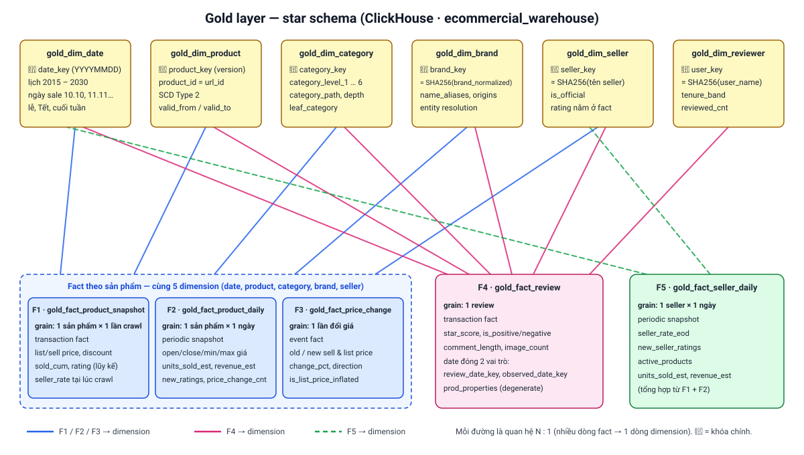
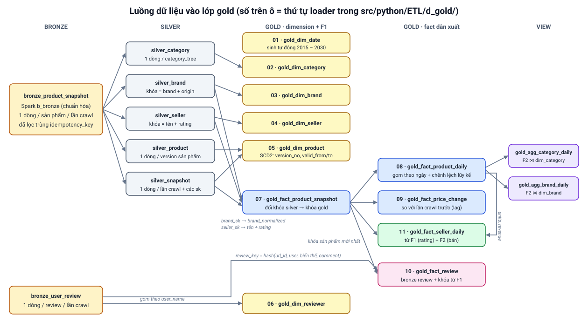

# Lớp Gold: mô hình dữ liệu (star schema)

> **Database:** ClickHouse `ecommercial_warehouse` · **DDL:** [`src/sql_script/clickhouse/ddl/gold_ddl.sql`](src/sql_script/clickhouse/ddl/gold_ddl.sql) · **Loader:** [`src/python/ETL/d_gold/`](src/python/ETL/d_gold/)
>
> Cập nhật: 2026-11-14. Các con số về số dòng, dung lượng và thời gian lấy từ lần chạy thử với bộ dữ liệu test khoảng 10 triệu dòng (xem [mục 11](#11-khối-lượng-và-hiệu-năng)). Nếu tài liệu và code lệch nhau thì **code là chuẩn**. Khi sửa DDL hoặc loader của gold, nhớ cập nhật lại file này.

## Mục lục

1. [Tổng quan](#1-tổng-quan)
2. [Quy ước chung](#2-quy-ước-chung)
3. [Bus matrix](#3-bus-matrix)
4. [Quan hệ giữa các bảng](#4-quan-hệ-giữa-các-bảng)
5. [Dimension](#5-dimension)
6. [Fact](#6-fact)
7. [View tổng hợp](#7-view-tổng-hợp)
8. [Luồng biến đổi dữ liệu](#8-luồng-biến-đổi-dữ-liệu)
9. [Cách nạp và tính idempotent](#9-cách-nạp-và-tính-idempotent)
10. [Kiểm tra chất lượng dữ liệu](#10-kiểm-tra-chất-lượng-dữ-liệu)
11. [Khối lượng và hiệu năng](#11-khối-lượng-và-hiệu-năng)
12. [Truy vấn mẫu](#12-truy-vấn-mẫu)
13. [Hạn chế đã biết và lưu ý khi phân tích](#13-hạn-chế-đã-biết-và-lưu-ý-khi-phân-tích)
14. [Thuật ngữ](#14-thuật-ngữ)

---

## 1. Tổng quan

Lớp gold là tầng phục vụ phân tích của pipeline:

```
Crawler → Kafka → raw → bronze → silver → GOLD → dashboard / truy vấn phân tích
```

Gold được tổ chức theo **star schema** gồm 6 dimension, 5 fact và 2 view tổng hợp. Toàn bộ được dựng bằng SQL chạy trực tiếp trên ClickHouse. Dashboard đọc lớp data mart dựng từ gold, xem [MART_LAYER.md](MART_LAYER.md).



| Nhóm | Bảng |
|---|---|
| Dimension | `gold_dim_date`, `gold_dim_product`, `gold_dim_category`, `gold_dim_brand`, `gold_dim_seller`, `gold_dim_reviewer` |
| Fact | `gold_fact_product_snapshot` (F1), `gold_fact_product_daily` (F2), `gold_fact_price_change` (F3), `gold_fact_review` (F4), `gold_fact_seller_daily` (F5) |
| View | `gold_agg_category_daily`, `gold_agg_brand_daily` |

**Những câu hỏi lớp gold trả lời được:**

| Câu hỏi | Bảng dùng |
|---|---|
| Doanh số và doanh thu *ước tính* theo sản phẩm, brand, seller, danh mục, ngày | F2, F5, 2 view |
| Ngày sale (10.10, 11.11, Black Friday) có thật sự làm tăng lượng bán không | F2 × `gold_dim_date.sale_event` |
| Lịch sử giá, mức giảm thật, sản phẩm nghi "giảm giá ảo" (nâng giá gốc trước ngày sale) | F3 |
| Phân bố sao, tỉ lệ review tiêu cực, tỉ lệ review có ảnh theo danh mục hoặc brand | F4 |
| Seller official so với seller thường; uy tín seller thay đổi theo thời gian | F5, `gold_dim_seller.is_official` |
| Thuộc tính sản phẩm (tên, xuất xứ, bảo hành) thay đổi theo thời gian | `gold_dim_product` (SCD2) |

**Các quyết định thiết kế chính:**
- **Brand, seller, category gắn thẳng vào fact**, không đi qua `gold_dim_product`. Như vậy schema là star chứ không phải snowflake, và mỗi lần quan sát giữ đúng brand, seller, category tại thời điểm đó.
- **Khóa surrogate là hash của khóa tự nhiên.** Nhờ vậy khóa luôn giống nhau qua các lần nạp lại, và loader không cần tra bảng.
- **Gold sửa lại khóa của silver ở hai chỗ:**
  - Brand gộp theo `brand_normalized`. Silver tách thêm theo `brand_origin`.
  - Seller gộp theo tên. Silver tách thêm theo rating.

  Đây là bước entity resolution cho brand và seller.
- **Mọi bảng dùng `ReplacingMergeTree`**, và loader tính lại toàn bộ dữ liệu mỗi lần chạy. Chạy lại bao nhiêu lần cũng không bị nhân đôi.

---

## 2. Quy ước chung

| Quy ước | Ý nghĩa |
|---|---|
| Tên bảng | `gold_dim_*` là dimension, `gold_fact_*` là fact, `gold_agg_*` là view tổng hợp |
| Khóa surrogate (`*_key`, kiểu `String`) | `lower(hex(SHA256(<khóa tự nhiên>)))`, chuỗi 64 ký tự hex, cùng cách sinh với silver |
| `product_id` và `product_key` | `product_id = url_id` là **khóa bền**, chung cho mọi version của một sản phẩm. `product_key` là khóa của **một version** (SCD2) |
| `date_key` | `UInt32` dạng `YYYYMMDD`, ví dụ `20261111` |
| Thời gian | Mọi cột `DateTime` dùng múi giờ `Asia/Ho_Chi_Minh`. `observed_at` là lúc crawler nhìn thấy trang, **không phải** thời điểm của Kafka |
| Tiền | `UInt64`, đơn vị VND, số nguyên. Riêng các cột trung bình `avg_sell_price` là `Float64` |
| Hậu tố `_cum`, `_eod` | Giá trị **lũy kế**, hoặc giá trị **cuối ngày** (end of day) |
| Hậu tố `_est` | Giá trị **ước tính**, không phải số liệu gốc (ví dụ `units_sold_est`) |
| Hậu tố `_pct` | Phần trăm, thang 0–100 |
| `NULL` | Nghĩa là **chưa biết**, khác với 0. Ví dụ ngày đầu tiên của sản phẩm có `units_sold_est = NULL` |
| Member "unknown" | Brand hoặc seller trống trỏ về `SHA256('unknown')`, hiển thị là "Không rõ thương hiệu" / "Không rõ người bán". Category trống có `category_path = 'unknown'`. Tên reviewer trống được gộp về `user_name = 'unknown'` |
| `updated_at` | Có ở mọi bảng. Là cột version của `ReplacingMergeTree`: khi trùng khóa, dòng có `updated_at` lớn nhất được giữ |
| Khóa chống trùng | Chính là `ORDER BY` của bảng |
| **Truy vấn phải dùng `FINAL`** | `ReplacingMergeTree` chỉ gộp dòng trùng khi merge chạy nền. Muốn kết quả chính xác thì viết `FROM bảng AS t FINAL`. Hai view đã dùng sẵn `FINAL` |

---

## 3. Bus matrix

Dấu ✓ nghĩa là fact có khóa tới dimension đó.

| Fact | Grain | date | product | category | brand | seller | reviewer |
|---|---|:-:|:-:|:-:|:-:|:-:|:-:|
| F1 `gold_fact_product_snapshot` | 1 sản phẩm × 1 lần crawl | ✓ | ✓ | ✓ | ✓ | ✓ | |
| F2 `gold_fact_product_daily` | 1 sản phẩm × 1 ngày | ✓ | ✓ | ✓ | ✓ | ✓ | |
| F3 `gold_fact_price_change` | 1 lần đổi giá | ✓ | ✓ | ✓ | ✓ | ✓ | |
| F4 `gold_fact_review` | 1 review | ✓✓ (2 vai trò) | ✓ | ✓ | ✓ | ✓ | ✓ |
| F5 `gold_fact_seller_daily` | 1 seller × 1 ngày | ✓ | | | | ✓ | |

---

## 4. Quan hệ giữa các bảng

ClickHouse **không ép khóa ngoại**. Tính toàn vẹn của khóa được kiểm tra bằng script (xem [mục 10](#10-kiểm-tra-chất-lượng-dữ-liệu)).

| Bảng fact | Cột | → Bảng dimension.cột | Quan hệ | Ghi chú |
|---|---|---|---|---|
| F1, F2, F3, F5 | `date_key` | `gold_dim_date.date_key` | N : 1 | F3 dùng ngày của `changed_at` |
| F4 | `review_date_key` | `gold_dim_date.date_key` | N : 1 | Ngày viết review (ước tính). Giá trị `0` là không xác định, nên dùng `LEFT JOIN` |
| F4 | `observed_date_key` | `gold_dim_date.date_key` | N : 1 | Ngày crawler đọc review. Đây là *role-playing dimension*: cùng một dim_date nhưng đóng 2 vai trò |
| F1, F3 | `product_key` | `gold_dim_product.product_key` | N : 1 | Version của sản phẩm **tại thời điểm quan sát** |
| F2 | `product_key` | `gold_dim_product.product_key` | N : 1 | Version **cuối ngày** |
| F4 | `product_key` | `gold_dim_product.product_key` | N : 1 | Version **hiện tại** của sản phẩm. Là `''` nếu sản phẩm chưa có snapshot |
| F1, F2, F3, F4 | `product_id` | `gold_dim_product.product_id` | N : N | Một `product_id` có nhiều version. Muốn lấy thuộc tính hiện tại thì join kèm `is_current = true` |
| F1, F2, F3, F4 | `brand_key` | `gold_dim_brand.brand_key` | N : 1 | |
| F1, F2, F3, F4, F5 | `seller_key` | `gold_dim_seller.seller_key` | N : 1 | |
| F1, F2, F3, F4 | `category_key` | `gold_dim_category.category_key` | N : 1 | |
| F4 | `user_key` | `gold_dim_reviewer.user_key` | N : 1 | |

**Quan hệ dẫn xuất giữa các fact** (fact này được tính từ fact kia, không phải khóa ngoại):
- F2 và F3 được tính từ F1.
- F5 lấy rating từ F1 và lượng bán từ F2.
- F4 lấy `product_key`, `brand_key`, `seller_key`, `category_key` từ lần quan sát mới nhất của sản phẩm trong F1.

---

## 5. Dimension

### 5.1 `gold_dim_date`: lịch

- **Tác dụng:** cắt và lọc mọi fact theo ngày, tuần, tháng, quý, năm. Đánh dấu ngày lễ, Tết, cuối tuần, và **ngày sale** (ngày đôi, Black Friday) để đo hiệu ứng khuyến mãi.
- **Grain:** 1 ngày. Khóa: `date_key`. Phạm vi: 2015-01-01 → 2030-12-31, tổng 5.844 dòng.
- **Nguồn:** không đọc bảng nào, sinh bằng `numbers()`. Loader: [`01_load_gold_dim_date.sql`](src/python/ETL/d_gold/01_load_gold_dim_date.sql). Chạy một lần là đủ.

| Cột | Kiểu | Mô tả / cách tính |
|---|---|---|
| `date_key` | UInt32 | 🔑 `toYYYYMMDD(ngày)` |
| `full_date` | Date | Ngày |
| `day` | UInt8 | Ngày trong tháng (1–31) |
| `day_of_week` | UInt8 | 1 = Thứ Hai … 7 = Chủ Nhật |
| `day_name` | LowCardinality(String) | 'Thứ Hai' … 'Chủ Nhật' |
| `week_of_year` | UInt8 | Tuần theo chuẩn ISO |
| `month`, `quarter`, `year` | UInt8, UInt8, UInt16 | Tháng, quý, năm |
| `year_month` | UInt32 | `YYYYMM`, dùng để lọc hoặc gộp theo tháng |
| `is_weekend` | Bool | Thứ Bảy hoặc Chủ Nhật |
| `is_double_day` | Bool | Ngày trùng tháng: 1.1, 2.2 … 11.11, 12.12 |
| `is_black_friday` | Bool | Thứ Sáu rơi vào ngày 23–29/11 |
| `is_tet` | Bool | Mùng 1–3 Tết Nguyên Đán (tra theo bảng ngày mùng 1 Tết 2015–2030 trong loader) |
| `holiday_name` | LowCardinality(String) | 'Tết Dương lịch', 'Tết Nguyên Đán', 'Giải phóng miền Nam', 'Quốc tế Lao động', 'Quốc khánh', hoặc `''` |
| `sale_event` | LowCardinality(String) | 'Black Friday', '11.11', '10.10', …, hoặc `''`. Black Friday được ưu tiên trước ngày đôi |
| `updated_at` | DateTime | Thời điểm nạp |

### 5.2 `gold_dim_product`: sản phẩm (SCD Type 2)

- **Tác dụng:** mô tả sản phẩm và **giữ lịch sử thay đổi thuộc tính**. Khi title, nơi sản xuất (`made_in`) hoặc bảo hành (`warranty`) đổi, bảng sinh một version mới. Nhờ đó fact luôn trỏ đúng tới thuộc tính tại thời điểm quan sát.
- **Grain:** 1 version của 1 sản phẩm. Khóa: `product_key` (bảng `ORDER BY (product_id, product_key)`). Khóa bền: `product_id`. Hiện có 51.479 version của 50.000 sản phẩm, trong đó 1.479 sản phẩm có 2 version.
- **Nguồn:** `silver_product` (mỗi `product_sk` là một version) và `silver_snapshot` (lấy thời điểm version xuất hiện lần đầu). Loader: [`05_load_gold_dim_product.sql`](src/python/ETL/d_gold/05_load_gold_dim_product.sql).
- **Cách biến đổi:**
  1. Lấy `silver_product` với `url_id > 0`, giữ 1 dòng cho mỗi `product_sk`.
  2. `valid_from` = `min(observed_at)` của `product_sk` đó trong `silver_snapshot`. Nếu không tìm thấy thì dùng `valid_from` của silver.
  3. Với mỗi `product_id`, sắp các version theo `valid_from`:
     - `version_no` = `row_number()`;
     - `valid_to` = `valid_from` của version kế tiếp (`leadInFrame`);
     - `is_current` = `valid_to IS NULL`.
  4. Loader tính lại toàn bộ lịch sử mỗi lần chạy, nên version cũ được "đóng" mà không cần `ALTER … UPDATE`.
  5. Silver chỉ giữ một dòng cho mỗi `product_sk`. Vì vậy nếu sản phẩm quay lại đúng bộ thuộc tính cũ (A → B → A), version A **không được mở lại**, xem [mục 13.17](#13-hạn-chế-đã-biết-và-lưu-ý-khi-phân-tích).

| Cột | Kiểu | Mô tả / cách tính |
|---|---|---|
| `product_key` | String | 🔑 = `silver_product.product_sk` = SHA256(url_id ‖ title ‖ made_in ‖ warranty) |
| `product_id` | Int64 | `url_id`, khóa bền, chung cho mọi version |
| `title` | String | Tên sản phẩm (đã chuẩn hóa và đổi chữ thường ở bronze) |
| `made_in` | LowCardinality(String) | Nơi sản xuất |
| `warranty` | LowCardinality(String) | Bảo hành (đã chuẩn hóa, 'không' nếu không có) |
| `description` | String | Mô tả. Thay đổi mô tả **không** tạo version mới |
| `version_no` | UInt16 | 1, 2, … theo thứ tự thời gian |
| `valid_from` | DateTime | Lần đầu crawler thấy version này |
| `valid_to` | Nullable(DateTime) | Lúc version kế tiếp xuất hiện. `NULL` nghĩa là đang hiệu lực. Khoảng hiệu lực là `[valid_from, valid_to)` |
| `is_current` | Bool | `true` nếu là version mới nhất |
| `updated_at` | DateTime | Thời điểm nạp |

Ví dụ thật từ dữ liệu test, sản phẩm 1000134 đổi title ngày 30/10:

| version_no | title | valid_from | valid_to | is_current |
|---|---|---|---|---|
| 1 | áo sơ mi nam … vepora - mã 6619 | 2026-10-08 00:30:48 | 2026-10-30 14:11:17 | false |
| 2 | áo sơ mi nam … vepora - mã 6619 mẫu mới 2026 | 2026-10-30 14:11:17 | NULL | true |

### 5.3 `gold_dim_category`: danh mục

- **Tác dụng:** phân tích theo cây danh mục Tiki, cho phép drill-down từ cấp 1 xuống cấp 6.
- **Grain:** 1 `category_tree` khác nhau. Khóa: `category_key`. Hiện có 126 dòng.
- **Nguồn:** `silver_category`. Loader: [`02_load_gold_dim_category.sql`](src/python/ETL/d_gold/02_load_gold_dim_category.sql).
- **Cách biến đổi:**
  1. Mỗi `category_sk` giữ dòng mới nhất.
  2. Bỏ các cấp rỗng, rồi tính `category_path`, `category_depth`, `leaf_category`.
  3. `category_tree` rỗng sinh khóa `SHA256('')` = `e3b0c442…`, với `category_path = 'unknown'` và `category_depth = 0`.

| Cột | Kiểu | Mô tả / cách tính |
|---|---|---|
| `category_key` | String | 🔑 = `silver_category.category_sk` = SHA256(category_tree) |
| `category_path` | String | Các cấp không rỗng nối bằng `' > '`, ví dụ 'thời trang nam > áo thun nam > áo thun nam ba lỗ' |
| `category_level_1` … `_3` | LowCardinality(String) | Cấp 1–3 |
| `category_level_4` … `_6` | String | Cấp 4–6 (`''` nếu không có) |
| `category_depth` | UInt8 | Số cấp có giá trị |
| `leaf_category` | String | Cấp sâu nhất |
| `updated_at` | DateTime | Thời điểm nạp |

### 5.4 `gold_dim_brand`: thương hiệu

- **Tác dụng:** phân tích theo thương hiệu, sau khi đã **gộp các cách viết khác nhau của cùng một brand** (entity resolution). Ví dụ 'Andeo' và 'andeo' về cùng một brand.
- **Grain:** 1 `brand_normalized`. Khóa: `brand_key`. Hiện có 3.002 dòng, từ 5.850 dòng `silver_brand`. 721 brand được gộp từ nhiều cách viết.
- **Nguồn:** `silver_brand`. Loader: [`03_load_gold_dim_brand.sql`](src/python/ETL/d_gold/03_load_gold_dim_brand.sql).
- **Cách biến đổi:**
  1. Ở bronze, `normalize_brand()` ([`product_snapshot_norm.py`](src/python/ETL/b_bronze/preprocessing_func/product_snapshot_norm.py)) tạo `brand_normalized`: đổi chữ thường, bỏ dấu, bỏ 'official' / 'chính hãng' / 'flagship store', bỏ khoảng trắng và ký tự đặc biệt.
  2. Silver sinh `brand_sk` = hash(`brand_normalized`, `brand_origin`), nên một brand bị tách thành nhiều dòng theo xuất xứ. Gold **`GROUP BY brand_normalized`** và bỏ qua xuất xứ.
  3. Gold luôn thêm member `unknown` cho sản phẩm không có brand.

| Cột | Kiểu | Mô tả / cách tính |
|---|---|---|
| `brand_key` | String | 🔑 SHA256(`brand_normalized`). SHA256('unknown') khi không có brand |
| `brand_normalized` | String | Khóa entity resolution |
| `brand_name` | String | Tên hiển thị, là tên gốc khác rỗng xuất hiện nhiều nhất trong các dòng `silver_brand` (`topK`, là hàm xấp xỉ). Nếu không có tên gốc nào thì dùng `brand_normalized`. Với unknown là 'Không rõ thương hiệu' |
| `brand_origin` | LowCardinality(String) | Một xuất xứ khác rỗng, chọn bằng `topK` trên các dòng `silver_brand`. `silver_brand` chỉ có một dòng cho mỗi cặp brand + xuất xứ, nên khi brand có nhiều xuất xứ thì giá trị này chỉ là một trong số đó, không phải xuất xứ phổ biến nhất. Danh sách đủ nằm ở `brand_origins` |
| `brand_origins` | Array(String) | Mọi xuất xứ đã thấy. Ví dụ 'oem' có nhiều nước |
| `name_aliases` | Array(String) | Các cách viết tên gốc đã được gộp về brand này |
| `is_unknown` | Bool | `true` với member unknown |
| `first_seen_at` | DateTime | Lần đầu brand xuất hiện (`min(valid_from)`) |
| `updated_at` | DateTime | Thời điểm nạp |

### 5.5 `gold_dim_seller`: người bán

- **Tác dụng:** phân tích theo người bán, và phân biệt shop official với shop thường.
- **Grain:** 1 tên seller. Khóa: `seller_key`. Hiện có 7.733 dòng (2.745 seller official), từ 205.706 dòng `silver_seller`.
- **Nguồn:** `silver_seller`. Loader: [`04_load_gold_dim_seller.sql`](src/python/ETL/d_gold/04_load_gold_dim_seller.sql).
- **Cách biến đổi:**
  - Silver sinh `seller_sk` = hash(tên, rating, số lượt đánh giá), nên mỗi lần seller có thêm đánh giá lại thành một "seller mới". Gold **`GROUP BY` tên**.
  - Rating của seller thay đổi liên tục nên **không nằm trong dim**. Rating được đưa sang F1 và F5.

| Cột | Kiểu | Mô tả / cách tính |
|---|---|---|
| `seller_key` | String | 🔑 SHA256(tên seller). SHA256('unknown') khi không có tên |
| `seller_name` | String | Tên seller (chữ thường, theo bronze). Với unknown là 'Không rõ người bán' |
| `is_official` | Bool | Tên chứa 'official' hoặc 'chính hãng', hoặc đúng bằng 'tiki trading' |
| `is_unknown` | Bool | `true` với member unknown |
| `first_seen_at` | DateTime | Lần đầu seller xuất hiện |
| `updated_at` | DateTime | Thời điểm nạp |

### 5.6 `gold_dim_reviewer`: người viết review

- **Tác dụng:** phân tích review theo đặc điểm người viết: thâm niên tài khoản, mức độ tích cực đánh giá.
- **Grain:** 1 `user_name`. Khóa: `user_key`. Hiện có 7.200 dòng.
- **Nguồn:** **`bronze_user_review`**, vì gold được viết khi `silver_user` chưa có. Loader: [`06_load_gold_dim_reviewer.sql`](src/python/ETL/d_gold/06_load_gold_dim_reviewer.sql).
- **Cách biến đổi:** `GROUP BY user_name`, tên trống gộp về 'unknown'. Các thuộc tính lấy theo **lần quan sát mới nhất** (`argMax(…, observed_at)`).

| Cột | Kiểu | Mô tả / cách tính |
|---|---|---|
| `user_key` | String | 🔑 SHA256(user_name) |
| `user_name` | String | Tên hiển thị (chữ thường) |
| `joined_at_est` | Nullable(DateTime) | Ngày tham gia **ước tính** = `observed_at − joined_duration` (số giờ). Nguồn ghi "Đã tham gia 7 năm" nên chỉ chính xác theo năm hoặc tháng. `NULL` khi không đọc được (`joined_duration = 0`) |
| `tenure_band` | LowCardinality(String) | Nhóm thâm niên theo `joined_duration`: 'dưới 1 năm', '1-3 năm', '3-5 năm', 'trên 5 năm', hoặc 'không rõ' khi không đọc được |
| `reviewed_cnt` | UInt32 | Số đánh giá người này đã viết |
| `thank_received` | UInt32 | Số lượt cảm ơn đã nhận |
| `first_seen_at`, `last_seen_at` | DateTime | Lần đầu và lần cuối thấy user trong dữ liệu crawl |
| `updated_at` | DateTime | Thời điểm nạp |

---

## 6. Fact

Measure trong fact được chia làm ba loại, quyết định cách tổng hợp:

| Loại measure | Cách tổng hợp | Ví dụ |
|---|---|---|
| **Additive** | `sum` được theo mọi chiều, kể cả thời gian | `units_sold_est`, `revenue_est`, `new_ratings` |
| **Semi-additive** | `sum` được theo sản phẩm hoặc seller **tại cùng một thời điểm**, nhưng **không** được `sum` theo thời gian. Theo thời gian thì lấy giá trị cuối (`argMax`) | `sold_cum`, `sold_eod`, `product_rate_cnt` |
| **Non-additive** | Chỉ dùng `avg`, `min`, `max`, không `sum` | Giá, `discount_pct`, `product_rate` |

### 6.1 F1 `gold_fact_product_snapshot`

- **Grain: 1 sản phẩm × 1 lần crawl.** Đây là fact chi tiết nhất. Mọi fact sản phẩm khác đều tính từ bảng này.
- **Khóa trùng:** `(product_id, observed_at)`. `PARTITION BY toYYYYMM(observed_at)`.
- **Nguồn:** `silver_snapshot` + `silver_brand` + `silver_seller`. Loader: [`07_load_gold_fact_product_snapshot.sql`](src/python/ETL/d_gold/07_load_gold_fact_product_snapshot.sql).
- **Cách biến đổi:**
  1. `silver_snapshot` `LEFT JOIN silver_brand` theo `brand_sk` để lấy `brand_normalized`. Gold tính lại `brand_key` = SHA256(`brand_normalized`).
  2. `LEFT JOIN silver_seller` theo `seller_sk` để lấy tên seller, rating và số lượt đánh giá *tại lúc crawl*. Gold tính lại `seller_key` = SHA256(tên).
  3. Chuẩn hóa giá, xem bảng dưới.
  4. Không lọc trùng trong câu `SELECT`, vì `ReplacingMergeTree` tự gộp. Dùng `LIMIT 1 BY` ở đây làm ClickHouse hết RAM khi có 10 triệu dòng.
  5. Bỏ các dòng `url_id = 0`, là dữ liệu nạp trước khi silver có cột `url_id`.

| Cột | Kiểu | Loại | Mô tả / cách tính |
|---|---|---|---|
| `product_id` | Int64 | khóa | `url_id` |
| `observed_at` | DateTime | khóa | Lúc crawler nhìn thấy trang |
| `date_key` | UInt32 | FK | `toYYYYMMDD(observed_at)` → dim_date |
| `hour_of_day` | UInt8 | thuộc tính | Giờ crawl (0–23) |
| `product_key` | String | FK | `silver_snapshot.product_sk` → version tại thời điểm crawl |
| `brand_key` | String | FK | Xem bước 1 |
| `seller_key` | String | FK | Xem bước 2 |
| `category_key` | String | FK | `silver_snapshot.category_sk` |
| `list_price` | UInt64 | non-additive | Giá gốc. Tiki chỉ hiện giá gốc khi có giảm giá, nên lấy `price` nếu > 0, ngược lại lấy `sell_price` |
| `sell_price` | UInt64 | non-additive | Giá bán thực tế (VND). **0 nghĩa là nguồn thiếu giá** |
| `discount_amount` | UInt64 | non-additive | `list_price − sell_price` (≥ 0). Khi `sell_price = 0` mà vẫn có giá gốc thì cột này bằng cả giá gốc, xem [mục 13.3](#13-hạn-chế-đã-biết-và-lưu-ý-khi-phân-tích) |
| `discount_pct` | Float32 | non-additive | `discount` của nguồn nếu > 0. Nếu không, tính từ `list_price` và `sell_price`. Nếu vẫn không được thì 0 |
| `sold_cum` | UInt32 | **semi-additive** | Số "đã bán" lũy kế hiển thị trên trang. **0 có thể là ô bị trống** (bronze đổi rỗng thành 0), không chắc là chưa bán. F2 đã xử lý, xem [mục 6.2](#62-f2-gold_fact_product_daily-fact-chính-để-phân-tích) |
| `product_rate` | Float32 | non-additive | Điểm đánh giá trung bình (0–5). 0 nghĩa là chưa có đánh giá |
| `product_rate_cnt` | UInt32 | semi-additive | Số lượt đánh giá lũy kế. Giống `sold_cum`, 0 có thể là ô trống |
| `seller_rate` | Float32 | non-additive | Rating của seller tại lúc crawl |
| `seller_rate_cnt` | UInt32 | semi-additive | Số lượt đánh giá seller lũy kế. 0 có thể là ô trống. F5 lấy thẳng giá trị này, chưa làm sạch như F2 |
| `updated_at` | DateTime | | Thời điểm nạp |

### 6.2 F2 `gold_fact_product_daily`: fact chính để phân tích

- **Grain: 1 sản phẩm × 1 ngày có ít nhất một lần crawl.** Đây là periodic snapshot. Ngày không crawl thì không có dòng.
- **Khóa trùng:** `(product_id, date_key)`. `PARTITION BY intDiv(date_key, 100)`, tức theo tháng.
- **Nguồn:** F1. Loader: [`08_load_gold_fact_product_daily.sql`](src/python/ETL/d_gold/08_load_gold_fact_product_daily.sql).
- **Cách biến đổi:**
  1. Từ F1, so mỗi lần quan sát với lần trước (`lagInFrame`) để đếm số lần đổi giá bán trong ngày.
  2. **Làm sạch bộ đếm lũy kế.** `sold_cum` và `product_rate_cnt` được thay bằng **max lũy kế** theo thời gian của từng sản phẩm: `max(sold_cum) OVER (PARTITION BY product_id ORDER BY observed_at ROWS BETWEEN UNBOUNDED PRECEDING AND CURRENT ROW)`. Bộ đếm "đã bán" chỉ tăng, nên một lần crawl đọc ra 0 vì ô trống sẽ giữ mức cao nhất đã thấy thay vì kéo bộ đếm về 0. Thiếu bước này, một lần crawl trống ở cuối ngày làm `sold_eod = 0` và ngày hôm sau bị tính bán bằng **toàn bộ** số lũy kế (xem [mục 13.16](#13-hạn-chế-đã-biết-và-lưu-ý-khi-phân-tích)).
  3. Gom theo `(date_key, product_id)`: giá mở và đóng cửa (`argMin` / `argMax` theo `observed_at`), giá min, max, trung bình, các giá trị cuối ngày, số lần quan sát.
  4. So mỗi ngày với **ngày có quan sát trước đó** của cùng sản phẩm:
     - `units_sold_est` = `max(sold_eod − sold_eod_trước, 0)`. Ngày đầu tiên là `NULL`. Sau bước 2, `sold_eod` không bao giờ giảm nên hiệu luôn ≥ 0 ; `max(…, 0)` chỉ còn là chốt an toàn;
     - `revenue_est` = `units_sold_est × avg_sell_price`;
     - `new_ratings` tính tương tự từ `rating_cnt_eod`.

Ví dụ thật, sản phẩm 1000003. F1 có 5–6 lần crawl mỗi ngày, F2 gom lại thành một dòng mỗi ngày:

| date_key | open / close sell_price | sold_eod | units_sold_est | revenue_est | n_observations | price_change_cnt |
|---|---|---|---|---|---|---|
| 20261008 | 3.615.000 / 3.615.000 | 7 | NULL (ngày đầu) | NULL | 5 | 0 |
| 20261009 | 3.615.000 / 3.615.000 | 16 | 9 | 32.535.000 | 6 | 0 |
| 20261010 (10.10) | 2.812.000 / 2.812.000 | 49 | 33 | 92.796.000 | 6 | 1 |
| 20261011 | 3.615.000 / 3.615.000 | 58 | 9 | 32.535.000 | 5 | 1 |

| Cột | Kiểu | Loại | Mô tả / cách tính |
|---|---|---|---|
| `date_key` | UInt32 | khóa, FK | Ngày |
| `product_id` | Int64 | khóa | `url_id` |
| `product_key`, `brand_key`, `seller_key`, `category_key` | String | FK | Giá trị của lần quan sát **cuối ngày** |
| `open_sell_price` / `close_sell_price` | UInt64 | non-additive | Giá bán ở lần quan sát đầu và cuối ngày |
| `min_sell_price` / `max_sell_price` | UInt64 | non-additive | Giá bán thấp nhất và cao nhất trong ngày. `min_sell_price = 0` nếu trong ngày có lần crawl thiếu giá |
| `avg_sell_price` | Float64 | non-additive | Trung bình giá bán của các lần quan sát, **tính cả lần giá 0** (nguồn thiếu giá), xem [mục 13.3](#13-hạn-chế-đã-biết-và-lưu-ý-khi-phân-tích) |
| `close_list_price` | UInt64 | non-additive | Giá gốc cuối ngày |
| `avg_discount_pct` / `max_discount_pct` | Float32 | non-additive | % giảm trung bình và cao nhất trong ngày |
| `sold_eod` | UInt32 | semi-additive | "Đã bán" lũy kế cuối ngày, theo max lũy kế (bước 2), nên không bao giờ giảm |
| `units_sold_est` | Nullable(UInt32) | **additive** | Số lượng bán ước tính từ lần quan sát ngày trước tới cuối ngày này |
| `revenue_est` | Nullable(UInt64) | **additive** | `units_sold_est × avg_sell_price` |
| `rating_eod` | Float32 | non-additive | Điểm đánh giá ở lần crawl cuối ngày có điểm > 0 (`argMaxIf`) ; 0 nếu cả ngày không có điểm |
| `rating_cnt_eod` | UInt32 | semi-additive | Số lượt đánh giá lũy kế cuối ngày, theo max lũy kế (bước 2) |
| `new_ratings` | Nullable(UInt32) | additive | Số lượt đánh giá mới so với ngày trước |
| `days_since_prev_obs` | Nullable(UInt16) | thuộc tính | Số ngày từ lần có dữ liệu trước. **Giá trị > 1 nghĩa là `units_sold_est` gộp nhiều ngày không crawl** |
| `n_observations` | UInt32 | additive | Số lần crawl trong ngày |
| `price_change_cnt` | UInt32 | additive | Số lần **giá bán** đổi trong ngày, kể cả lần đổi so với cuối ngày hôm trước |
| `first_observed_at` / `last_observed_at` | DateTime | thuộc tính | Lần crawl đầu và cuối trong ngày |
| `updated_at` | DateTime | | Thời điểm nạp |

### 6.3 F3 `gold_fact_price_change`

- **Grain: 1 lần thay đổi giá bán hoặc giá gốc.** Đây là event fact: mỗi dòng là một lần quan sát mà `sell_price` hoặc `list_price` khác lần quan sát trước của cùng sản phẩm. Lần quan sát đầu tiên không tính là thay đổi.
- **Khóa trùng:** `(product_id, changed_at)`. `PARTITION BY toYYYYMM(changed_at)`.
- **Nguồn:** F1. Loader: [`09_load_gold_fact_price_change.sql`](src/python/ETL/d_gold/09_load_gold_fact_price_change.sql).
- **Cách biến đổi:**
  1. Dùng `lagInFrame` theo `product_id` để lấy giá bán, giá gốc và % giảm của lần quan sát trước.
  2. Giữ các lần quan sát *bắt đầu một mức giá mới*.
  3. Lấy `lag` thêm một lần trên tập này để biết mức giá cũ bắt đầu từ khi nào (`old_price_since`).
  4. **Phát hiện giảm giá ảo:** `is_list_price_inflated` = giá gốc tăng **và** % giảm cũng tăng. Đây là dấu hiệu shop nâng giá gốc để % giảm trông lớn hơn, trong khi giá bán gần như không đổi.

| Cột | Kiểu | Loại | Mô tả / cách tính |
|---|---|---|---|
| `product_id` | Int64 | khóa | `url_id` |
| `changed_at` | DateTime | khóa | Lần quan sát đầu tiên thấy giá mới |
| `date_key` | UInt32 | FK | `toYYYYMMDD(changed_at)` |
| `product_key`, `brand_key`, `seller_key`, `category_key` | String | FK | Tại lần quan sát đó |
| `old_sell_price` / `new_sell_price` | UInt64 | non-additive | Giá bán trước và sau |
| `change_amount` | Int64 | non-additive | `new − old` (âm là giảm giá) |
| `change_pct` | Float32 | non-additive | `change_amount / old_sell_price × 100`. Bằng 0 nếu giá cũ là 0 |
| `direction` | LowCardinality(String) | thuộc tính | 'up', 'down', hoặc 'unchanged' (chỉ giá gốc đổi). Dữ liệu test có 212.380 'up', 223.196 'down', không có 'unchanged' |
| `old_list_price` / `new_list_price` | UInt64 | non-additive | Giá gốc trước và sau |
| `old_discount_pct` / `new_discount_pct` | Float32 | non-additive | % giảm trước và sau |
| `old_price_since` | DateTime | thuộc tính | Mức giá cũ bắt đầu từ lúc nào |
| `old_price_duration_hours` | Float32 | non-additive | Mức giá cũ được giữ bao nhiêu giờ |
| `is_list_price_inflated` | Bool | cờ | Nghi giảm giá ảo, xem bước 4. Cờ cũng bật khi giá đi từ 0 (thiếu giá) lên giá thật, nên cần lọc `old_sell_price > 0 AND new_sell_price > 0` |
| `updated_at` | DateTime | | Thời điểm nạp |

Measure chính của F3 là `count()` (số lần đổi giá). Với `change_pct` và `old_price_duration_hours` thì dùng `avg`.

### 6.4 F4 `gold_fact_review`

- **Grain: 1 review**, đã gộp các lần crawl lại cùng một review. Nguồn không có `review_id`, nên khóa là `review_key`.
- **Khóa trùng:** `(product_id, review_key)`. **Không partition**, vì cùng một review có thể được crawl lại ở tháng khác. Nếu partition theo thời gian, `ReplacingMergeTree` sẽ không gộp được hai bản.
- **Nguồn:** **`bronze_user_review`** cho nội dung review, và F1 cho khóa sản phẩm. Loader: [`10_load_gold_fact_review.sql`](src/python/ETL/d_gold/10_load_gold_fact_review.sql).
- **Cách biến đổi:**
  1. `review_key` = SHA256(url_id ‖ user_name ‖ prod_properties ‖ comment). Mỗi `review_key` giữ lần quan sát mới nhất.
  2. Lấy khóa product, brand, seller, category từ **lần quan sát mới nhất** của sản phẩm trong F1.
  3. `reviewed_at_est` = `observed_at − rated_at` (số giờ). Nguồn ghi "Đánh giá vào 4 năm trước", nên chỉ chính xác theo năm, tháng hoặc tuần.
  4. Tính các measure văn bản: độ dài, số từ, số ảnh (`JSONLength(images_urls)`).

| Cột | Kiểu | Loại | Mô tả / cách tính |
|---|---|---|---|
| `review_key` | String | khóa (degenerate) | Xem bước 1 |
| `product_id` | Int64 | khóa | `url_id` |
| `product_key`, `brand_key`, `seller_key`, `category_key` | String | FK | Theo lần quan sát mới nhất của sản phẩm. `''` nếu sản phẩm chưa có trong F1 |
| `user_key` | String | FK | SHA256(user_name) → dim_reviewer |
| `reviewed_at_est` | Nullable(DateTime) | thuộc tính | Thời điểm viết review (ước tính). `NULL` nếu không parse được |
| `review_date_key` | UInt32 | FK (vai trò 1) | Ngày viết review. 0 nghĩa là không xác định |
| `observed_at` | DateTime | thuộc tính | Lần crawl mới nhất thấy review |
| `observed_date_key` | UInt32 | FK (vai trò 2) | Ngày crawl |
| `star_score` | UInt8 | non-additive | 1–5 sao. 0 nghĩa là không có sao |
| `is_positive` / `is_negative` | Bool | cờ | ≥ 4 sao / 1–2 sao. Lấy `avg` để ra tỉ lệ |
| `comment_length` | UInt32 | additive | Số ký tự của comment đã làm sạch ở bronze (chữ thường, bỏ dấu câu, bỏ emoji) |
| `word_count` | UInt32 | additive | Số từ |
| `image_count` | UInt16 | additive | Số ảnh đính kèm |
| `has_image` | Bool | cờ | `image_count > 0` |
| `use_time_hours` | Nullable(Float32) | non-additive | Thời gian đã dùng sản phẩm trước khi review (giờ) |
| `review_status` | LowCardinality(String) | degenerate | 'cực kì hài lòng', 'hài lòng', … |
| `prod_properties` | String | degenerate | Biến thể đã mua, ví dụ 'màu: be, size: free size' |
| `updated_at` | DateTime | | Thời điểm nạp |

### 6.5 F5 `gold_fact_seller_daily`

- **Grain: 1 seller × 1 ngày có ít nhất một sản phẩm được quan sát.** Đây là periodic snapshot.
- **Khóa trùng:** `(seller_key, date_key)`. `PARTITION BY intDiv(date_key, 100)`.
- **Nguồn:** F1 cho rating, số sản phẩm, giá; F2 cho lượng bán và doanh thu. Loader: [`11_load_gold_fact_seller_daily.sql`](src/python/ETL/d_gold/11_load_gold_fact_seller_daily.sql).
- **Cách biến đổi:**
  1. Từ F1, gom theo `(date_key, seller_key)`: rating cuối ngày, số sản phẩm khác nhau, giá và % giảm trung bình.
  2. Từ F2, cộng `units_sold_est` và `revenue_est` theo `(date_key, seller_key)`. Sản phẩm được gán cho seller **cuối ngày**.
  3. `new_seller_ratings` = chênh lệch `seller_rate_cnt_eod` so với ngày trước.

| Cột | Kiểu | Loại | Mô tả / cách tính |
|---|---|---|---|
| `date_key` | UInt32 | khóa, FK | Ngày |
| `seller_key` | String | khóa, FK | → dim_seller |
| `seller_rate_eod` | Float32 | non-additive | Rating seller cuối ngày |
| `seller_rate_cnt_eod` | UInt32 | semi-additive | Số lượt đánh giá seller lũy kế ở lần crawl cuối ngày (`argMax` giá trị thô của F1, chưa lấy max lũy kế như F2) |
| `new_seller_ratings` | Nullable(UInt32) | additive | Lượt đánh giá mới so với ngày trước. `NULL` ở ngày đầu |
| `active_products` | UInt32 | semi-additive | Số sản phẩm khác nhau của seller được quan sát trong ngày. **Không cộng theo ngày** |
| `avg_sell_price` | Float64 | non-additive | Trung bình `sell_price` của mọi lần crawl các sản phẩm của seller trong ngày. Sản phẩm crawl nhiều lần có trọng số lớn hơn, và lần giá 0 cũng được tính |
| `avg_discount_pct` | Float32 | non-additive | % giảm trung bình, cùng cách tính như `avg_sell_price` |
| `units_sold_est` | UInt64 | additive | Tổng `units_sold_est` của các sản phẩm. Phần chưa biết (`NULL` ở F2) được tính là 0 |
| `revenue_est` | UInt64 | additive | Tổng `revenue_est` |
| `updated_at` | DateTime | | Thời điểm nạp |

---

## 7. View tổng hợp

Hai view dựng sẵn cho dashboard. Cả hai đọc F2 với `FINAL`, nên luôn trả kết quả đã gộp trùng.

**`gold_agg_category_daily`**: grain là danh mục × ngày. Tính từ F2 `LEFT JOIN gold_dim_category`.

| Cột | Cách tính |
|---|---|
| `date_key`, `category_key`, `category_path`, `category_level_1`, `category_level_2` | Chiều phân tích |
| `products` | `uniqExact(product_id)` |
| `units_sold_est`, `revenue_est` | `sum` |
| `avg_sell_price`, `avg_discount_pct` | `avg` của giá trị theo từng sản phẩm (không trọng số) |
| `price_changes` | `sum(price_change_cnt)` |

**`gold_agg_brand_daily`**: grain là brand × ngày. Tính từ F2 `LEFT JOIN gold_dim_brand`.

| Cột | Cách tính |
|---|---|
| `date_key`, `brand_key`, `brand_name`, `brand_origin` | Chiều phân tích |
| `products`, `units_sold_est`, `revenue_est`, `avg_sell_price`, `avg_discount_pct` | Như view danh mục |
| `avg_rating` | `avg(rating_eod)`. ⚠️ Có tính cả sản phẩm chưa có đánh giá (rating 0), xem [mục 13](#13-hạn-chế-đã-biết-và-lưu-ý-khi-phân-tích) |

---

## 8. Luồng biến đổi dữ liệu



| # | Loader | Bảng đích | Đọc từ | Thời gian (10 triệu dòng) |
|---|---|---|---|---|
| 01 | `01_load_gold_dim_date.sql` | `gold_dim_date` | (sinh bằng `numbers()`) | 0,1 s |
| 02 | `02_load_gold_dim_category.sql` | `gold_dim_category` | `silver_category` | 0,1 s |
| 03 | `03_load_gold_dim_brand.sql` | `gold_dim_brand` | `silver_brand` | 0,2 s |
| 04 | `04_load_gold_dim_seller.sql` | `gold_dim_seller` | `silver_seller` | 0,2 s |
| 05 | `05_load_gold_dim_product.sql` | `gold_dim_product` | `silver_product`, `silver_snapshot` | 11 s |
| 06 | `06_load_gold_dim_reviewer.sql` | `gold_dim_reviewer` | `bronze_user_review` | 0,4 s |
| 07 | `07_load_gold_fact_product_snapshot.sql` | F1 | `silver_snapshot`, `silver_brand`, `silver_seller` | 65 s |
| 08 | `08_load_gold_fact_product_daily.sql` | F2 | F1 | 55 s |
| 09 | `09_load_gold_fact_price_change.sql` | F3 | F1 | 21 s |
| 10 | `10_load_gold_fact_review.sql` | F4 | `bronze_user_review`, F1 | 11 s |
| 11 | `11_load_gold_fact_seller_daily.sql` | F5 | F1, F2 | 7 s |
| | | | **Tổng** | **khoảng 3 phút** |

Thời gian lấy từ `system.query_log` của lần chạy `run_test_pipeline.sh gold` ngày 2026-11-14. Giữa các lần chạy, thời gian có thể lệch khoảng 20–30%.

**Thứ tự bắt buộc:** chạy dimension (01–06) trước fact, F1 (07) trước 08–11, và F2 (08) trước F5 (11).

---

## 9. Cách nạp và tính idempotent

**Tạo bảng (chỉ chạy một lần):** [`gold_ddl.sql`](src/sql_script/clickhouse/ddl/gold_ddl.sql) dùng `CREATE TABLE` không có `IF NOT EXISTS`, nên chạy lần hai sẽ báo lỗi bảng đã tồn tại.

**Nạp toàn bộ gold** (Git Bash, từ thư mục gốc dự án). Lệnh này tạo bảng nếu chưa có, `TRUNCATE` các bảng `gold_*`, rồi chạy 01 → 11:

```bash
bash src/sql_script/clickhouse/test_data/run_test_pipeline.sh gold
```

**Chạy một loader riêng lẻ:**

```bash
docker exec -i clickhouse_server clickhouse-client --user=clickhouse --password=<mật khẩu> \
  -d ecommercial_warehouse --multiquery \
  --max_bytes_before_external_sort=300000000 --max_bytes_before_external_group_by=300000000 \
  < src/python/ETL/d_gold/08_load_gold_fact_product_daily.sql
```

Hai tham số `max_bytes_before_external_*` buộc ClickHouse ghi tạm ra đĩa khi bộ nhớ dùng vượt 300 MB. Ở quy mô 10 triệu dòng, các loader silver bị hết RAM nếu thiếu hai tham số này, vì container ClickHouse chỉ có khoảng 2,7 GB. Script `run_test_pipeline.sh` đã truyền sẵn chúng cho mọi file SQL.

**Idempotent:**
- Mỗi loader **tính lại toàn bộ** từ silver, bronze hoặc F1. Bảng đích dùng `ReplacingMergeTree(updated_at)` với khóa trùng là `ORDER BY`. Chạy lại N lần không nhân đôi dữ liệu khi đọc bằng `FINAL`. Đã kiểm tra trong lần chạy thử: nạp 2 lần cho ra 2 bản ghi thô, nhưng đọc bằng `FINAL` vẫn chỉ còn 1 bản.
- Chạy lại mà **không** `TRUNCATE` thì không bị trùng. Nhưng những dòng đã biến mất ở nguồn (ví dụ dữ liệu test đã bị xóa) vẫn còn trong gold. Khi muốn dựng lại cho sạch thì dùng lệnh `gold` ở trên, lệnh này có `TRUNCATE`.
- Gold **chưa nạp tăng dần**. Mỗi lần chạy đọc lại toàn bộ dữ liệu, mất khoảng 3 phút cho 10 triệu dòng snapshot.

---

## 10. Kiểm tra chất lượng dữ liệu

Chạy bằng lệnh `bash src/sql_script/clickhouse/test_data/run_test_pipeline.sh check`. Nội dung kiểm tra nằm trong [`check_test_pipeline.sql`](src/sql_script/clickhouse/test_data/check_test_pipeline.sql). Kết quả lần chạy ngày 2026-11-14:

| Kiểm tra | Quy tắc | Kết quả |
|---|---|---|
| Toàn vẹn khóa | Mọi `*_key` trong F1 đều có trong dim tương ứng | ✅ 0 khóa thiếu ở cả 5 dim |
| Đối chiếu số dòng | `silver_snapshot` = F1; `silver_product` = `gold_dim_product` | ✅ 10.000.000 = 10.000.000; 51.479 = 51.479 |
| Đọc số lượt đánh giá dạng "tr+" | '(5.6tr+ đánh giá)' phải thành 5.600.000 ở bronze (mục 4b) | ✅ 20/20 giá trị |
| SCD2 | Số sản phẩm có > 1 version khớp với dữ liệu đã cài (khoảng 3%) | ✅ 1.479 sản phẩm |
| Gộp brand | Số dòng `gold_dim_brand` = số `brand_normalized` khác nhau | ✅ 5.850 dòng silver → 3.002 |
| Gộp seller | Số dòng `gold_dim_seller` = số tên seller khác nhau | ✅ 205.706 dòng silver → 7.733 |
| Gộp review crawl lại | Một review crawl nhiều lần chỉ còn 1 dòng | ✅ 524.389 dòng bronze → 499.990 |
| Hiệu ứng ngày sale | Ngày 10.10 và 11.11 phải bán nhiều hơn ngày thường | ✅ 37,2–37,3 so với 10,1 sản phẩm/ngày (×3,7 ; bộ sinh cài ×4) |
| Bộ đếm lũy kế không giảm | `sold_eod`, `rating_cnt_eod` của F2 không bao giờ nhỏ hơn ngày trước, dù F1 có lần crawl trống (mục 8b) | ✅ 0 lần giảm ; F1 có 47.780 lần crawl "đã bán" trống |
| Phát hiện giảm giá ảo | So `is_list_price_inflated` với "đáp án" đã cài trong bộ sinh dữ liệu | ✅ precision 0,97, recall 0,83 |

---

## 11. Khối lượng và hiệu năng

Đo ngày 2026-11-14 trên bộ dữ liệu test (`url_id ≥ 1.000.000`, 50.000 sản phẩm × 200 lần crawl). Raw hiện **không còn dòng crawl thật nào**, nên mọi con số trong tài liệu này chỉ là dữ liệu test. Các lần crawl kéo dài từ 07/10 23:50 đến 12/11 00:09, nên hai ngày 07/10 và 12/11 chỉ có khoảng 500 sản phẩm, còn mỗi ngày khác có đủ 50.000 sản phẩm.

| Bảng | Số dòng | Dung lượng nén | Tỉ lệ nén |
|---|---:|---:|---:|
| `gold_dim_date` | 5.844 | 37,6 KiB | 3,8 |
| `gold_dim_category` | 126 | 19,9 KiB | 1,6 |
| `gold_dim_brand` | 3.002 | 279 KiB | 1,7 |
| `gold_dim_seller` | 7.733 | 583 KiB | 1,4 |
| `gold_dim_product` | 51.479 | 6,7 MiB | 3,2 |
| `gold_dim_reviewer` | 7.200 | 650 KiB | 1,3 |
| F1 `gold_fact_product_snapshot` | 10.000.000 | 150,7 MiB | 22,6 |
| F2 `gold_fact_product_daily` | 1.750.985 | 78,7 MiB | 8,7 |
| F3 `gold_fact_price_change` | 435.576 | 35,2 MiB | 4,4 |
| F4 `gold_fact_review` | 499.990 | 84,4 MiB | 2,8 |
| F5 `gold_fact_seller_daily` | 271.569 | 6,0 MiB | 5,4 |

- F1 chứa cùng 10 triệu dòng như `silver_snapshot` nhưng chỉ nặng **151 MiB so với 2,47 GiB**. Lý do là F1 sắp theo `(product_id, observed_at)`, nên các khóa hash giống nhau nằm cạnh nhau và nén rất tốt. `silver_snapshot` thì sắp theo `observed_at`.
- Các truy vấn mẫu ở [mục 12](#12-truy-vấn-mẫu) đều chạy dưới 0,5 giây.

---

## 12. Truy vấn mẫu

Mọi truy vấn dưới đây đã được chạy thử trên dữ liệu 10 triệu dòng. Thời gian ghi trong ngoặc.

**Top brand theo doanh thu ước tính trong tháng 11** (0,29 s)

```sql
SELECT b.brand_name, sum(f.units_sold_est) AS units, sum(f.revenue_est) AS revenue
FROM gold_fact_product_daily AS f FINAL
INNER JOIN gold_dim_brand AS b FINAL ON b.brand_key = f.brand_key
INNER JOIN gold_dim_date  AS d FINAL ON d.date_key  = f.date_key
WHERE d.year_month = 202611 AND NOT b.is_unknown
GROUP BY b.brand_name
ORDER BY revenue DESC
LIMIT 5;
```

**Ngày sale có làm tăng lượng bán không** (0,18 s)

```sql
SELECT if(d.sale_event = '', 'ngày thường', d.sale_event) AS loai_ngay,
       round(avg(f.units_sold_est), 2)   AS ban_tb_moi_sp,
       round(avg(f.avg_discount_pct), 1) AS giam_gia_tb_pct
FROM gold_fact_product_daily AS f FINAL
INNER JOIN gold_dim_date AS d FINAL ON d.date_key = f.date_key
WHERE f.units_sold_est IS NOT NULL          -- bỏ ngày đầu tiên (chưa biết)
GROUP BY loai_ngay
ORDER BY ban_tb_moi_sp DESC;
```

Kết quả trên dữ liệu test: 11.11 bán trung bình 37,24 sản phẩm, 10.10 là 37,32, ngày thường là 10,08. (Trước bản sửa ở mục 13.16 là 43,92 / 41,28 / 16,11.)

**Lịch sử giá của một sản phẩm** (0,05 s)

```sql
SELECT changed_at, old_sell_price, new_sell_price, round(change_pct, 1) AS change_pct,
       direction, round(old_price_duration_hours, 1) AS gia_cu_giu_gio, is_list_price_inflated
FROM gold_fact_price_change FINAL
WHERE product_id = 1000003
  AND old_sell_price > 0 AND new_sell_price > 0   -- bỏ thay đổi giả do nguồn thiếu giá
ORDER BY changed_at;
```

**Seller có nhiều lần nghi giảm giá ảo trước 11.11** (0,14 s)

```sql
SELECT s.seller_name, count() AS lan_nang_gia_goc, uniqExact(f.product_id) AS so_san_pham
FROM gold_fact_price_change AS f FINAL
INNER JOIN gold_dim_seller AS s FINAL ON s.seller_key = f.seller_key
WHERE f.is_list_price_inflated
  AND f.old_sell_price > 0 AND f.new_sell_price > 0   -- bỏ cờ giả do giá quay lại từ 0
  AND f.changed_at BETWEEN '2026-11-01 00:00:00' AND '2026-11-11 23:59:59'
GROUP BY s.seller_name
ORDER BY lan_nang_gia_goc DESC
LIMIT 5;
```

**Chất lượng review theo danh mục cấp 1** (0,09 s)

```sql
SELECT c.category_level_1, count() AS reviews, round(avg(r.star_score), 2) AS sao_tb,
       round(avg(r.is_negative) * 100, 1) AS pct_tieu_cuc, round(avg(r.has_image) * 100, 1) AS pct_co_anh
FROM gold_fact_review AS r FINAL
INNER JOIN gold_dim_category AS c FINAL ON c.category_key = r.category_key
WHERE r.star_score > 0
GROUP BY c.category_level_1
ORDER BY reviews DESC
LIMIT 5;
```

**Seller official so với seller thường** (0,38 s)

```sql
SELECT s.is_official,
       uniqExact(f.product_id)                          AS so_san_pham,
       round(avg(f.avg_discount_pct), 1)                AS giam_gia_tb,
       round(avgIf(f.rating_eod, f.rating_cnt_eod > 0), 2) AS rating_tb,   -- bỏ sản phẩm chưa có đánh giá
       sum(f.revenue_est)                               AS doanh_thu_uoc_tinh
FROM gold_fact_product_daily AS f FINAL
INNER JOIN gold_dim_seller AS s FINAL ON s.seller_key = f.seller_key
GROUP BY s.is_official;
```

**SCD2: thuộc tính tại thời điểm quan sát so với thuộc tính hiện tại** (0,10 s)

```sql
SELECT f.observed_at,
       p.version_no,
       p.title   AS title_luc_quan_sat,   -- join theo product_key: đúng version tại thời điểm đó
       cur.title AS title_hien_tai        -- join theo product_id + is_current: version mới nhất
FROM gold_fact_product_snapshot AS f FINAL
INNER JOIN gold_dim_product AS p FINAL ON p.product_key = f.product_key
INNER JOIN (SELECT product_id, title FROM gold_dim_product FINAL WHERE is_current) AS cur
        ON cur.product_id = f.product_id
WHERE f.product_id = 1000134 AND f.date_key = 20261030
ORDER BY f.observed_at;
```

---

## 13. Hạn chế đã biết và lưu ý khi phân tích

**Lưu ý khi viết truy vấn:**

1. **Luôn dùng `FINAL`.** Nếu không, có thể đếm trùng những dòng chưa được merge.
2. **Không `sum` các cột lũy kế theo thời gian**, gồm `sold_cum`, `sold_eod`, `product_rate_cnt`, `rating_cnt_eod`, `seller_rate_cnt*`. Hãy dùng `units_sold_est` hoặc `new_ratings`.
3. **`sell_price = 0` nghĩa là nguồn thiếu giá** (ô giá trống hoặc ghi "Liên hệ"), không phải hàng miễn phí.
   - Trong dữ liệu test có 15.003 dòng như vậy ở F1.
   - Chúng tạo ra **29.794 lần "đổi giá" giả** ở F3 (6,8% số dòng), dạng giá → 0 rồi 0 → giá. 154 trong 4.311 cờ `is_list_price_inflated` là do giá quay lại từ 0.
   - F2 và F5 **chưa loại** các lần thiếu giá khi tính giá trong ngày. Ở F2, 14.956 ngày-sản phẩm có ít nhất một lần thiếu giá: `min_sell_price = 0` và `avg_sell_price` bị kéo xuống, nên `revenue_est` thấp hơn khoảng 46 tỷ ₫ (0,15% tổng doanh thu). 2.693 ngày-sản phẩm có `close_sell_price = 0`, 4 ngày-sản phẩm thiếu giá cả ngày.
   - Ở F1, nếu `sell_price = 0` mà vẫn có giá gốc thì `discount_amount` bằng cả giá gốc. `discount_pct` vẫn là % giảm nguồn ghi.
   - Khi phân tích giá, hãy lọc `sell_price > 0`, hoặc ở F3 lọc `old_sell_price > 0 AND new_sell_price > 0`.
4. **`rating = 0` nghĩa là chưa có đánh giá.** Trung bình rating cần dùng `avgIf(rating_eod, rating_cnt_eod > 0)`. Trên dữ liệu test, rating trung bình của F2 là 3,99 nếu không lọc và 4,25 nếu có lọc. View `gold_agg_brand_daily.avg_rating` hiện chưa lọc nên cũng bị thấp hơn thực tế.
5. `units_sold_est = NULL` ở ngày đầu tiên của sản phẩm là **chưa biết**, không phải 0. Riêng F5 cộng phần chưa biết thành 0.

**Hạn chế của dữ liệu và mô hình:**

6. **Doanh số chỉ là ước tính**, tính từ chênh lệch số "đã bán" lũy kế giữa các lần crawl.
   - Độ chính xác phụ thuộc tần suất crawl. Với chu kỳ khoảng 4,2 giờ, một phần lượng bán của ngày sale bị tính sang ngày hôm sau: dữ liệu test cài hiệu ứng gấp 4, gold đo được khoảng 3,7 lần (37,2 so với 10,1 sản phẩm/ngày), và ngày ngay sau sale bán 12,65 thay vì 10.
   - Nếu không crawl trong nhiều ngày, toàn bộ lượng bán dồn vào ngày có dữ liệu kế tiếp. Có thể nhận ra qua `days_since_prev_obs > 1`.
   - `revenue_est` dùng giá bán trung bình của ngày, vì không biết từng đơn vị được bán ở giá nào.
7. **Ngày viết review và ngày tham gia chỉ là ước tính**, vì nguồn ghi tương đối như "4 năm trước". Review cũ hơn năm 2015 sẽ không có trong `gold_dim_date`, nên cần `LEFT JOIN`. Trên dữ liệu test, mọi review đều đọc được ngày (từ 10/2021 đến 11/2026).
8. **Người viết review được nhận diện chỉ bằng tên hiển thị.** Hai người trùng tên bị gộp làm một. Bộ dữ liệu test ghép họ, tên đệm và tên nên chỉ có 7.200 tên khác nhau, và nhiều người dùng khác nhau đã bị gộp chung.
9. **`review_key` có chứa nội dung comment.** Hai review *không có nội dung* của cùng tên, cùng sản phẩm, cùng biến thể sẽ bị gộp làm một.
10. **`product_key` ở F4 là version hiện tại** của sản phẩm, không phải version tại thời điểm viết review.
11. **Entity resolution của brand và seller chỉ dựa trên quy tắc.** Bảng gộp được khác biệt về chữ hoa/thường, dấu, và hậu tố 'official' / 'chính hãng'. Bảng **không** bắt được lỗi chính tả hay tên viết tắt.
    - Seller chỉ được đổi chữ thường, chưa chuẩn hóa thêm.
    - `brand_name` được chọn trong các dòng của `silver_brand`, nên có thể ra cách viết chưa đẹp, ví dụ 'Ankuia Official', 'andeo'.
    - `name_aliases` chưa liệt kê đủ cách viết, vì `silver_brand` chỉ giữ một tên cho mỗi cặp brand + origin.
12. **Đã sửa ngày 2026-11-14: `normalize_rating_count` ở bronze đọc sai dạng "tr+".** Trước bản sửa, '(5.6tr+ đánh giá)' bị đọc thành 56, nên `seller_rate_cnt` của các seller rất lớn (ví dụ Tiki Trading) ở F1 và F5 bị sai. Hàm giờ nhận cả hậu tố 'tr' / 'triệu' (×1.000.000) và 'k' / 'nghìn' / 'ngàn' (×1.000). Dữ liệu nạp trước bản sửa cần chạy lại bronze → silver → gold mới đúng. Kiểm tra bằng mục 4b của `check_test_pipeline.sql`.
13. **`is_list_price_inflated` là quy tắc heuristic.** Trên dữ liệu test, quy tắc bỏ sót khoảng 17% trường hợp và báo nhầm khoảng 3%. Một phần báo nhầm là do giá quay lại từ 0 (mục 3). Mart M7 dùng giá tham chiếu 30 ngày nên chính xác hơn, xem [MART_LAYER.md](MART_LAYER.md).
14. `gold_dim_reviewer` và F4 đang đọc thẳng `bronze_user_review`. Bảng `silver_user` và `silver_review` đã có DDL nhưng gold chưa dùng. Khi chuyển sang đọc silver, cần thống nhất khóa chống trùng của review giữa hai tầng.
15. Gold tính lại toàn bộ mỗi lần chạy, chưa nạp tăng dần (xem [mục 9](#9-cách-nạp-và-tính-idempotent)).
16. **Đã sửa ngày 2026-11-14: số "đã bán" bị trống làm số bán tăng vọt.** Bronze (`normalize_sold`, `normalize_rating_count`) đổi ô trống thành 0. Trước bản sửa, F2 lấy `sold_eod = argMax(sold_cum, observed_at)`: nếu lần crawl cuối ngày bị trống thì `sold_eod = 0`, và ngày hôm sau `units_sold_est` bằng toàn bộ số lũy kế.
    - Ví dụ sản phẩm 1044005, ngày 10/11 các lần crawl đọc được `[5032, 5032, 5033, 5033, 5034, 0]`. F2 ghi bán 0 cái ngày 10/11 và 5.048 cái ngày 11/11. Sau bản sửa: 3 cái và 14 cái.
    - Trên dữ liệu test, 47.780 lần crawl (0,48%) bị trống, làm 8.166 ngày-sản phẩm có `sold_eod` tụt về 0. Tổng `units_sold_est` giảm từ 30.054.952 xuống 19.868.597 (−33,9%), `revenue_est` từ 46.091.918.917.153 xuống 30.273.539.037.174 (−34,3%).
    - Hiệu ứng ngày sale đo được tăng từ ×2,7 lên ×3,7, gần với ×4 mà bộ sinh dữ liệu cài.
    - Cách sửa: loader 08 dùng **max lũy kế** của `sold_cum` và `product_rate_cnt` (mục 6.2 bước 2). `rating_eod` lấy lần crawl cuối ngày có điểm > 0. F1 vẫn giữ giá trị thô.
    - Đánh đổi: nếu Tiki thật sự reset "đã bán" của một sản phẩm về số nhỏ hơn, phần bán sau reset chỉ được tính khi vượt lại mức cũ, tức tính thiếu chứ không tính thừa.
    - Kiểm tra bằng mục 8b của `check_test_pipeline.sql`. Dữ liệu nạp trước bản sửa chỉ cần chạy lại gold 08 → 11 rồi bước `mart`.
    - Chưa áp dụng cho `seller_rate_cnt` của F5 vì dữ liệu test không có lần trống nào ở cột này.
17. **SCD2 không mở lại version cũ.** `silver_product` chỉ giữ một dòng cho mỗi `product_sk`. Nếu sản phẩm đổi title A → B rồi quay lại A, gold vẫn coi B là version hiện tại. Các lần quan sát sau đó trỏ về `product_key` của A, nằm ngoài khoảng `[valid_from, valid_to)` của A. Dữ liệu test không có trường hợp này: mọi dòng F1 đều nằm trong khoảng hiệu lực của version nó trỏ tới, và version ở lần quan sát cuối của mỗi sản phẩm luôn là `is_current`.

---

## 14. Thuật ngữ

| Thuật ngữ | Nghĩa |
|---|---|
| **Grain** | Mỗi dòng của bảng fact đại diện cho cái gì, ví dụ "1 sản phẩm × 1 ngày" |
| **Dimension / Fact** | Dimension là bảng mô tả ngữ cảnh (ai, cái gì, khi nào). Fact là bảng chứa số đo của sự kiện |
| **Star schema** | Các fact ở giữa, nối trực tiếp tới các dimension, không có dimension con |
| **Khóa surrogate / khóa tự nhiên** | Khóa tự nhiên là định danh từ nguồn (`url_id`, tên brand). Khóa surrogate là khóa kỹ thuật do kho dữ liệu sinh ra (`*_key`) |
| **Khóa bền (durable key)** | Định danh không đổi qua các version, ở đây là `product_id` |
| **SCD Type 2** | Slowly Changing Dimension loại 2: thuộc tính đổi thì sinh dòng mới, có `valid_from`, `valid_to`, `is_current`, nên giữ được lịch sử |
| **Periodic snapshot** | Fact chụp trạng thái theo chu kỳ cố định, ví dụ mỗi ngày (F2, F5) |
| **Event fact** | Mỗi dòng là một sự kiện xảy ra, ví dụ một lần đổi giá (F3) |
| **Additive / semi-additive / non-additive** | Measure cộng được theo mọi chiều / không cộng được theo thời gian / không cộng được, xem [mục 6](#6-fact) |
| **Degenerate dimension** | Thuộc tính mô tả nằm ngay trong fact, không có bảng dim riêng, ví dụ `prod_properties`, `review_status` |
| **Role-playing dimension** | Một dimension được dùng nhiều vai trò trong cùng một fact, ví dụ `gold_dim_date` vừa là ngày viết vừa là ngày crawl review |
| **Unknown member** | Dòng dim đặc biệt cho giá trị thiếu, để fact không bị mất liên kết |
| **Entity resolution** | Gộp các cách ghi khác nhau của cùng một thực thể (brand, seller) về một khóa |
| **`ReplacingMergeTree` / `FINAL`** | Engine ClickHouse tự gộp các dòng trùng khóa `ORDER BY` khi merge, giữ dòng có `updated_at` lớn nhất. `FINAL` ép gộp ngay khi đọc |
