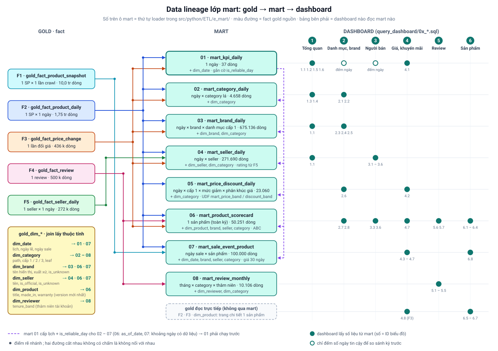

# Lớp Data Mart: bảng phục vụ dashboard

> **Database:** ClickHouse `ecommercial_warehouse` · **DDL:** [`src/sql_script/clickhouse/ddl/mart_ddl.sql`](src/sql_script/clickhouse/ddl/mart_ddl.sql) · **Loader:** [`src/python/ETL/e_mart/`](src/python/ETL/e_mart/) · **Truy vấn dashboard:** [`src/sql_script/clickhouse/query_dashboard/`](src/sql_script/clickhouse/query_dashboard/README.md) · **Kiểm tra:** [`check_mart.sql`](src/sql_script/clickhouse/test_data/check_mart.sql)
>
> Cập nhật: 2026-11-14. Số dòng, thời gian và ví dụ lấy từ bộ dữ liệu test khoảng 10 triệu dòng (xem [GOLD_LAYER.md mục 11](GOLD_LAYER.md#11-khối-lượng-và-hiệu-năng)). Nếu tài liệu và code lệch nhau thì **code là chuẩn**. Khi sửa DDL hoặc loader của mart, nhớ cập nhật file này và lược đồ [`docs/images/mart_lineage.svg`](docs/images/mart_lineage.svg).

## Mục lục

1. [Tổng quan](#1-tổng-quan)
2. [Quy ước chung](#2-quy-ước-chung)
3. [Data lineage](#3-data-lineage)
4. [Bộ measure dùng chung của M1–M4](#4-bộ-measure-dùng-chung-của-m1m4)
5. [Mô tả từng mart](#5-mô-tả-từng-mart)
6. [Cách nạp và tính idempotent](#6-cách-nạp-và-tính-idempotent)
7. [Kiểm tra chất lượng dữ liệu](#7-kiểm-tra-chất-lượng-dữ-liệu)
8. [Cách dùng mart khi viết truy vấn](#8-cách-dùng-mart-khi-viết-truy-vấn)
9. [Lỗi "đã bán" ở gold phát hiện khi dựng mart (đã sửa)](#9-lỗi-đã-bán-ở-gold-phát-hiện-khi-dựng-mart-đã-sửa)
10. [Hạn chế và lưu ý](#10-hạn-chế-và-lưu-ý)
11. [Thuật ngữ](#11-thuật-ngữ)

---

## 1. Tổng quan

Lớp mart là tầng cuối của pipeline, nằm giữa gold và dashboard:

```
Crawler → Kafka → raw → bronze → silver → gold (star schema) → MART → 6 dashboard / 43 truy vấn
```

Gold được thiết kế để **đúng và đủ chi tiết**: mỗi fact giữ grain nhỏ nhất, dimension tách riêng, truy vấn phải `JOIN` và `FINAL`. Mart được thiết kế để **dashboard đọc nhanh và mọi biểu đồ dùng cùng một định nghĩa**:

- **Đọc nhanh.** Dashboard không phải `JOIN` dimension, không phải `FINAL`, không phải quét 10 triệu dòng F1 mỗi lần refresh. Cả 43 truy vấn chạy dưới 2,1 giây.
- **Một định nghĩa cho mọi biểu đồ.** Các quy tắc nghiệp vụ được áp **một lần** trong loader thay vì lặp lại (và dễ quên) ở từng truy vấn: bỏ giá 0, bỏ rating 0, bỏ "đổi giá giả", bỏ ngày crawl chưa đủ, đánh dấu member unknown.
- **Thêm phân tích gold chưa có:** cờ ngày tin cậy, phân khúc giá và mức giảm giá, xếp hạng ABC, so sánh 7 ngày, giá tham chiếu 30 ngày quanh ngày sale để phát hiện giảm giá ảo.

| # | Mart | Grain | Số dòng | Trả lời câu hỏi |
|---|---|---|---:|---|
| M1 | `mart_kpi_daily` | 1 ngày | 37 | Toàn sàn mỗi ngày bán bao nhiêu, giá và % giảm thế nào, ngày nào đủ tin cậy |
| M2 | `mart_category_daily` | ngày × category lá | 4.658 | Danh mục nào lớn, tăng nhanh ; drill-down cấp 1 → cấp 2 |
| M3 | `mart_brand_daily` | ngày × brand × danh mục cấp 1 | 675.056 | Thị phần brand, thị trường có bị vài brand chi phối không |
| M4 | `mart_seller_daily` | ngày × seller | 271.569 | Seller nào dẫn đầu, official có hơn shop thường không, uy tín seller đổi thế nào |
| M5 | `mart_price_discount_daily` | ngày × cấp 1 × mức giảm × phân khúc giá | 23.058 | Phân khúc giá nào tạo doanh thu, giảm sâu hơn có bán nhiều hơn không |
| M6 | `mart_product_scorecard` | 1 sản phẩm (toàn kỳ) | 50.000 | Hồ sơ đầy đủ của từng sản phẩm: bán, giá, review, ABC, xu hướng 7 ngày |
| M7 | `mart_sale_event_product` | ngày sale × sản phẩm | 100.000 | Ngày sale có rẻ thật không, ai giảm giá ảo, ngày sale bán gấp bao nhiêu lần |
| M8 | `mart_review_monthly` | tháng × category × thâm niên reviewer | 10.100 | Khách hài lòng tới đâu, danh mục nào bị chê, reviewer lâu năm có khó tính hơn không |

Tổng dung lượng khoảng 130 MiB, trong đó M3 chiếm 67 MiB vì một brand bán ở nhiều danh mục.

---

## 2. Quy ước chung

| Quy ước | Ý nghĩa |
|---|---|
| Tên bảng | `mart_*`. Loader `01`–`08` trong `src/python/ETL/e_mart/`, chạy theo thứ tự số |
| Engine | `MergeTree` thường, **không** `PARTITION BY`. Truy vấn **không cần `FINAL`** |
| Cách nạp | Dựng `<mart>__stage` → `INSERT` toàn bộ → `ALTER TABLE <mart> REPLACE PARTITION tuple() FROM <mart>__stage` → `DROP` stage. Xem [mục 6](#6-cách-nạp-và-tính-idempotent) |
| Ngày | `full_date` (kiểu `Date`) dùng để lọc ; `date_key` (`YYYYMMDD`) giữ lại để join ngược về gold |
| Tiền | `UInt64` hoặc `Float64` (khi là tổng để chia), đơn vị VND |
| Hậu tố `_sum` | Tổng của một giá trị, chỉ dùng làm tử số. Ví dụ `sell_price_sum / priced_products` = giá TB |
| Hậu tố `_pct` | Phần trăm, thang 0–100 |
| Hậu tố `_est` | Ước tính (kế thừa từ gold), không phải số liệu gốc |
| `NULL` | Chưa biết hoặc không tính được (ví dụ `growth_7d_pct` khi 7 ngày trước bằng 0). `units_sold_est = NULL` của gold được cộng như 0, kèm cột `products_sales_known` để biết bao nhiêu sản phẩm đã có số bán |
| Member unknown | `brand_is_unknown`, `seller_is_unknown` để lọc. Tên hiển thị là "Không rõ thương hiệu" / "Không rõ người bán". Category trống có `category_level_1 = 'unknown'` |
| `is_reliable_day` | `false` nếu ngày đó crawl được < 90% số sản phẩm của ngày đông nhất, hoặc < 90% sản phẩm có `units_sold_est`. Tính ở M1, chép sang M2–M5. **Mọi truy vấn dashboard theo ngày lọc cờ này** |
| Phân khúc | Hàm `mart_price_band(giá)` và `mart_discount_band(% giảm)` trong `mart_ddl.sql`, dùng chung cho M5, M6, M7 để các dashboard khớp nhau. Nhãn có tiền tố số (`'1. < 100k'`) để sắp theo chữ cũng đúng thứ tự |

**Phân khúc giá** (`mart_price_band`, theo giá bán): `0. không rõ giá` (= 0) · `1. < 100k` · `2. 100k-300k` · `3. 300k-1tr` · `4. 1tr-3tr` · `5. 3tr-10tr` · `6. >= 10tr`.

**Mức giảm giá** (`mart_discount_band`, theo % giảm): `0. không giảm` · `1. < 10%` · `2. 10-20%` · `3. 20-30%` · `4. 30-40%` · `5. >= 40%`.

**Loại measure** quyết định cách gộp:

| Loại | Cách gộp | Ví dụ |
|---|---|---|
| **additive** | `sum` theo mọi chiều, kể cả thời gian | `units_sold_est`, `revenue_est`, `new_ratings`, `price_changes`, các cột `*_sum`, `star_1`…`star_5` |
| **đếm sản phẩm** | `sum` theo category / brand / seller **trong cùng một ngày** (mỗi sản phẩm thuộc đúng một nhóm mỗi ngày). `sum` theo ngày ra "sản phẩm-ngày", chia cho số ngày ra "sản phẩm TB / ngày" | `products_observed`, `priced_products`, `rated_products` |
| **semi-additive** | Không `sum` theo ngày. Lấy giá trị cuối kỳ (`argMax(…, full_date)`) | `seller_rate_cnt_eod` |
| **non-additive** | Không `sum`. Tính lại từ thành phần, hoặc chỉ đọc ở đúng grain | `sales_coverage_pct`, `seller_rate_eod`, `active_brands`, `active_sellers`, các tỉ lệ ở M6, M7 |

**Quy tắc nghiệp vụ đã áp trong loader** (so với đọc thẳng gold, xem GOLD_LAYER.md mục 13):

| Quy tắc | Lý do |
|---|---|
| Giá bán chỉ tính `close_sell_price > 0` | 0 nghĩa là nguồn thiếu giá |
| Rating chỉ tính `rating_cnt_eod > 0` | 0 nghĩa là chưa có đánh giá. Sửa luôn sai lệch của view `gold_agg_brand_daily.avg_rating` |
| Đổi giá chỉ tính `old_sell_price > 0 AND new_sell_price > 0` | Bỏ 29.794 "đổi giá giả" dạng giá → 0 → giá |
| Số brand / seller hoạt động không tính khóa `SHA256('unknown')` | Member unknown không phải brand / seller thật |

---

## 3. Data lineage



Cách đọc lược đồ:
- **Bên trái → giữa:** mỗi màu đường là một fact gold. Ví dụ đường xanh dương (F2) đi vào 7 mart: F2 là nguồn chính của mọi số bán và giá.
- **Ô vàng:** dimension gold được `JOIN` để lấy tên và thuộc tính, kèm số của mart dùng nó.
- **Đường tím nét đứt:** M2–M7 đọc `mart_kpi_daily` để lấy lịch và cờ `is_reliable_day`, nên loader `01` phải chạy trước.
- **Bên phải:** ma trận mart × dashboard, số dưới chấm là ID biểu đồ trong `query_dashboard/0x_*.sql`.

| Loader | Bảng đích | Đọc từ gold | Đọc từ mart | Thời gian (10 triệu dòng) |
|---|---|---|---|---:|
| `01_load_mart_kpi_daily.sql` | M1 | F2, F3, `gold_dim_date` | | 6 s |
| `02_load_mart_category_daily.sql` | M2 | F2, F3, `gold_dim_category` | M1 | 8 s |
| `03_load_mart_brand_daily.sql` | M3 | F2, F3, `gold_dim_brand`, `gold_dim_category` | M1 | 26 s |
| `04_load_mart_seller_daily.sql` | M4 | F2, F3, F5, `gold_dim_seller`, `gold_dim_category` | M1 | 21 s |
| `05_load_mart_price_discount_daily.sql` | M5 | F2, `gold_dim_category` | M1 | 5 s |
| `06_load_mart_product_scorecard.sql` | M6 | F2, F3, F4, `gold_dim_product`, `gold_dim_brand`, `gold_dim_seller`, `gold_dim_category` | M1 (`as_of_date`) | 13 s |
| `07_load_mart_sale_event_product.sql` | M7 | F1, F2, `gold_dim_date`, `gold_dim_brand`, `gold_dim_seller`, `gold_dim_category` | M1 (khoảng ngày) | 51 s |
| `08_load_mart_review_monthly.sql` | M8 | F4, `gold_dim_reviewer`, `gold_dim_category` | | 3 s |
| | | | **Tổng** | **khoảng 2,2 phút** |

**Thứ tự bắt buộc:** gold `01`–`11` xong → mart `01` → mart `02`–`08` (thứ tự giữa `02`–`08` không quan trọng, nhưng script chạy theo số).

**Mart nào phục vụ dashboard nào** (chi tiết từng biểu đồ ở [`query_dashboard/README.md`](src/sql_script/clickhouse/query_dashboard/README.md)):

| Mart | 1 Tổng quan | 2 Danh mục, brand | 3 Người bán | 4 Giá, KM | 5 Review | 6 Sản phẩm |
|---|---|---|---|---|---|---|
| M1 | 1.1 1.2 1.5 1.6 | đếm ngày | đếm ngày | 4.1 | | |
| M2 | 1.3 1.4 | 2.1 2.2 | | | | |
| M3 | 1.1 | 2.3 2.4 2.5 | | | | |
| M4 | 1.1 | | 3.1 – 3.6 | | | |
| M5 | | 2.6 | | 4.2 | | |
| M6 | | 2.7 2.8 | 3.3 3.6 | 4.7 | 5.6 5.7 | 6.1 – 6.4 |
| M7 | | | | 4.3 – 4.7 | | 6.8 |
| M8 | | | | | 5.1 – 5.5 | |
| gold trực tiếp | | | | 4.8 (F3) | | 6.5 – 6.7 (F2, F3, dim_product) |

---

## 4. Bộ measure dùng chung của M1–M4

M1, M2, M3, M4 có chung 17 cột measure dưới đây. Chúng chỉ khác nhau ở **cột nhóm**: M1 nhóm theo ngày, M2 theo ngày × category, M3 theo ngày × brand × danh mục cấp 1, M4 theo ngày × seller. Vì cùng một cách tính, tổng của mọi mart luôn bằng nhau và bằng gold.

| Cột | Kiểu | Loại | Cách tính trên các dòng F2 (hoặc F3) của nhóm |
|---|---|---|---|
| `products_observed` | UInt32 | đếm SP | `count()`: số sản phẩm có ít nhất 1 lần crawl trong ngày |
| `products_sales_known` | UInt32 | đếm SP | `countIf(units_sold_est IS NOT NULL)`. Mẫu số của "bán TB / sản phẩm" |
| `products_selling` | UInt32 | đếm SP | `countIf(units_sold_est > 0)` |
| `units_sold_est` | UInt64 | additive | `sum(units_sold_est)`, `NULL` tính là 0 |
| `revenue_est` | UInt64 | additive | `sum(revenue_est)`, `NULL` tính là 0 |
| `priced_products` | UInt32 | đếm SP | `countIf(close_sell_price > 0)` |
| `sell_price_sum` | Float64 | additive | `sumIf(close_sell_price, close_sell_price > 0)` |
| `discount_pct_sum` | Float64 | additive | `sum(avg_discount_pct)`. Chia cho `products_observed` ra % giảm TB |
| `discounted_products` | UInt32 | đếm SP | `countIf(avg_discount_pct > 0)` |
| `deep_discount_products` | UInt32 | đếm SP | `countIf(max_discount_pct >= 30)` |
| `rated_products` | UInt32 | đếm SP | `countIf(rating_cnt_eod > 0)` |
| `rating_sum` | Float64 | additive | `sumIf(rating_eod, rating_cnt_eod > 0)` |
| `new_ratings` | UInt64 | additive | `sum(new_ratings)` |
| `price_changes` | UInt32 | additive | Số dòng F3 cùng ngày và cùng nhóm, với `old_sell_price > 0 AND new_sell_price > 0` |
| `price_up` / `price_down` | UInt32 | additive | Phần của `price_changes` có `direction = 'up'` / `'down'` |
| `inflated_events` | UInt32 | additive | Phần của `price_changes` có `is_list_price_inflated` (gold nghi giảm giá ảo) |

Sản phẩm được gán vào nhóm theo khóa **cuối ngày** của F2. Đổi giá được gán theo khóa **tại lần đổi giá** của F3.

**Công thức chỉ số** (đúng ở mọi cấp gộp: category cấp 2 → cấp 1, ngày → tháng):

| Chỉ số | Công thức |
|---|---|
| Giá niêm yết TB (không trọng số) | `sum(sell_price_sum) / sum(priced_products)` |
| Giá bán bình quân theo số bán | `sum(revenue_est) / sum(units_sold_est)` |
| % giảm TB | `sum(discount_pct_sum) / sum(products_observed)` |
| % sản phẩm có giảm giá | `sum(discounted_products) / sum(products_observed) * 100` |
| Rating TB (bỏ sản phẩm chưa có đánh giá) | `sum(rating_sum) / sum(rated_products)` |
| Bán TB / sản phẩm / ngày | `sum(units_sold_est) / sum(products_sales_known)` |
| % sản phẩm có bán (sell-through) | `sum(products_selling) / sum(products_sales_known) * 100` |
| Sản phẩm TB / ngày | `sum(products_observed) / số ngày tin cậy` |
| Tăng trưởng so kỳ trước | So **trung bình / ngày tin cậy** của hai kỳ, để kỳ trước thiếu ngày không phóng đại % |

---

## 5. Mô tả từng mart

### 5.1 M1 `mart_kpi_daily`: KPI toàn sàn theo ngày

- **Tác dụng:** cung cấp các con số tổng của toàn sàn mỗi ngày cho thẻ KPI và đường xu hướng: doanh thu, số bán, giá, % giảm, rating, số lần đổi giá. Đây cũng là **bảng lịch của lớp mart**: gắn cờ `is_reliable_day` để loại những ngày crawl chưa đủ, và cung cấp ngày sale, `as_of_date`, khoảng ngày có dữ liệu cho các mart khác.
- **Grain:** 1 ngày có dữ liệu ở F2. **Khóa:** `full_date`. Hiện có 37 dòng (07/10 → 12/11/2026), trong đó 34 ngày tin cậy.
- **Nguồn:** F2, F3, `gold_dim_date`. **Loader:** [`01_load_mart_kpi_daily.sql`](src/python/ETL/e_mart/01_load_mart_kpi_daily.sql). **Phải chạy đầu tiên.**
- **Dashboard dùng:** 1.1, 1.2, 1.5, 1.6, 4.1. Các biểu đồ 1.3, 2.1, 2.3, 2.5, 3.2, 3.3 đọc M1 để đếm số ngày tin cậy khi so sánh kỳ trước.
- **Cách tạo:**
  1. Gom F2 (`FINAL`) theo `date_key` thành [bộ measure chung](#4-bộ-measure-dùng-chung-của-m1m4), cộng thêm `uniqExact` brand và seller (bỏ khóa unknown).
  2. Gom F3 (`FINAL`) theo `date_key`, chỉ lấy dòng có giá cũ và giá mới > 0: đếm số lần đổi giá, tăng, giảm, nghi giảm giá ảo.
  3. `INNER JOIN gold_dim_date` để lấy thứ, cuối tuần, ngày lễ, ngày sale. `LEFT JOIN` kết quả F3 (ngày không đổi giá ra 0).
  4. Tính `sales_coverage_pct`, rồi `max(products_observed) OVER ()` để so mỗi ngày với ngày đông nhất, ra `is_reliable_day`.
  5. Ghi vào bảng stage rồi `REPLACE PARTITION`.

| Cột | Kiểu | Loại | Mô tả / cách tính |
|---|---|---|---|
| `full_date` | Date | 🔑 khóa | Ngày |
| `date_key` | UInt32 | thuộc tính | `YYYYMMDD`, để join ngược về gold |
| `day_of_week` | UInt8 | thuộc tính | 1 = Thứ Hai … 7 = Chủ Nhật (từ `gold_dim_date`) |
| `day_name` | LowCardinality(String) | thuộc tính | 'Thứ Hai' … 'Chủ Nhật' |
| `is_weekend` | Bool | thuộc tính | Thứ Bảy hoặc Chủ Nhật |
| `sale_event` | LowCardinality(String) | thuộc tính | '10.10', '11.11', 'Black Friday'… hoặc `''` |
| `holiday_name` | LowCardinality(String) | thuộc tính | Tên ngày lễ hoặc `''` |
| *17 cột measure chung* | | | Xem [mục 4](#4-bộ-measure-dùng-chung-của-m1m4) |
| `sales_coverage_pct` | Float32 | non-additive | `products_sales_known / products_observed * 100` |
| `is_reliable_day` | Bool | cờ | `products_observed >= 0,9 × max(products_observed)` **và** `sales_coverage_pct >= 90` |
| `active_brands` | UInt32 | non-additive | Số brand khác nhau có sản phẩm được crawl trong ngày, không tính unknown |
| `active_sellers` | UInt32 | non-additive | Số seller khác nhau, không tính unknown |
| `updated_at` | DateTime | | Thời điểm nạp |

Ví dụ thật (giá TB = `sell_price_sum / priced_products`, % giảm = `discount_pct_sum / products_observed`):

| full_date | sale_event | products_observed | sales_coverage_pct | is_reliable_day | units_sold_est | revenue_est | giá TB | % giảm | price_changes | inflated_events |
|---|---|---:|---:|---|---:|---:|---:|---:|---:|---:|
| 2026-10-07 | | 499 | 0 | false | 0 | 0 | 1.524.982 | 13,3 | 0 | 0 |
| 2026-10-08 | | 50.000 | 0,998 | false | 10.237 | 7.277.359.800 | 1.547.379 | 12,9 | 0 | 0 |
| 2026-11-03 | | 50.000 | 100 | true | 499.853 | 781.858.609.001 | 1.567.565 | 13,0 | 0 | 0 |
| 2026-11-04 | | 50.000 | 100 | true | 499.430 | 789.398.418.005 | 1.588.539 | 14,7 | 5.037 | 4.157 |
| 2026-11-11 | 11.11 | 50.000 | 100 | true | 1.861.921 | 2.636.154.434.298 | 1.419.041 | 24,3 | 22.410 | 0 |
| 2026-11-12 | | 486 | 100 | false | 3.611 | 6.517.027.000 | 1.596.439 | 12,5 | 289 | 0 |

- 07/10 và 12/11 chỉ crawl được khoảng 500 sản phẩm (đầu và cuối kỳ crawl).
- 08/10 là ngày đầu tiên của đa số sản phẩm nên chưa tính được số bán (coverage 0,998%).
- Ngày 04/11 có 4.157 lần nghi giảm giá ảo: đúng ngày bộ sinh dữ liệu bắt đầu nâng giá gốc trước 11.11.

### 5.2 M2 `mart_category_daily`: hiệu suất danh mục theo ngày

- **Tác dụng:** so sánh danh mục với nhau và theo dõi từng danh mục qua thời gian. Grain là category **lá** nhưng có sẵn `category_level_1/2/3`, nên dashboard drill-down cấp 1 → cấp 2 chỉ bằng `GROUP BY`, không cần `JOIN`.
- **Grain:** 1 ngày × 1 `category_key` (category lá). **Khóa:** `(full_date, category_key)`. Hiện có 4.658 dòng (126 category × 37 ngày, trừ ngày category không có sản phẩm).
- **Nguồn:** F2, F3, `gold_dim_category`, M1. **Loader:** [`02_load_mart_category_daily.sql`](src/python/ETL/e_mart/02_load_mart_category_daily.sql).
- **Dashboard dùng:** 1.3, 1.4, 2.1, 2.2.
- **Cách tạo:**
  1. Gom F2 theo `(date_key, category_key)` thành bộ measure chung, cộng `uniqExact` brand và seller.
  2. Gom F3 theo `(date_key, category_key)` (category tại lần đổi giá).
  3. `INNER JOIN` M1 để lấy `full_date`, `sale_event`, `is_weekend`, `is_reliable_day`. `LEFT JOIN gold_dim_category` để lấy đường dẫn và các cấp. `LEFT JOIN` kết quả F3.
  4. Category trống (`category_path = ''` hoặc cấp 1 rỗng) đổi thành `'unknown'`.

| Cột | Kiểu | Loại | Mô tả / cách tính |
|---|---|---|---|
| `full_date`, `date_key` | Date, UInt32 | 🔑 khóa | Ngày |
| `sale_event`, `is_weekend`, `is_reliable_day` | | thuộc tính / cờ | Chép từ M1 |
| `category_key` | String | 🔑 khóa | = `gold_dim_category.category_key` (SHA256 của category_tree) |
| `category_path` | String | thuộc tính | 'thời trang nam > áo thun nam > áo thun nam ngắn tay có cổ' ; 'unknown' nếu trống |
| `category_level_1` | LowCardinality(String) | thuộc tính | Cấp 1 ; 'unknown' nếu trống |
| `category_level_2`, `category_level_3` | LowCardinality(String) | thuộc tính | Cấp 2, 3 ; `''` nếu không có |
| `leaf_category` | String | thuộc tính | Cấp sâu nhất ; 'unknown' nếu trống |
| *17 cột measure chung* | | | Xem [mục 4](#4-bộ-measure-dùng-chung-của-m1m4) |
| `active_brands`, `active_sellers` | UInt32 | non-additive | Số brand / seller khác nhau của category trong ngày, không tính unknown |
| `updated_at` | DateTime | | Thời điểm nạp |

Ví dụ thật, category 'thời trang nam > áo thun nam > áo thun nam ngắn tay có cổ':

| full_date | sale_event | products_observed | products_selling | units_sold_est | revenue_est | giá TB | % giảm | rating | price_changes |
|---|---|---:|---:|---:|---:|---:|---:|---:|---:|
| 2026-11-10 | | 393 | 278 | 3.686 | 6.983.095.765 | 1.892.946 | 14,3 | 4,27 | 278 |
| 2026-11-11 | 11.11 | 393 | 280 | 13.802 | 24.380.759.933 | 1.742.832 | 23,0 | 4,27 | 157 |

### 5.3 M3 `mart_brand_daily`: thương hiệu theo ngày và danh mục

- **Tác dụng:** xếp hạng thương hiệu, tính thị phần và **độ tập trung thị trường (HHI)** trong từng danh mục. Có `category_level_1` trong grain nên dashboard lọc theo danh mục vẫn ra đúng thị phần của brand **trong danh mục đó**, không phải doanh thu cả brand. Brand đã qua entity resolution ở gold ('Andeo' và 'andeo' là một brand).
- **Grain:** 1 ngày × 1 brand × 1 danh mục cấp 1. **Khóa:** `(full_date, brand_key, category_level_1)`. Hiện có 675.056 dòng, là mart lớn nhất, vì trong dữ liệu test mỗi brand bán ở nhiều danh mục. Muốn số của cả brand thì `sum` theo `category_level_1`.
- **Nguồn:** F2, F3, `gold_dim_brand`, `gold_dim_category`, M1. **Loader:** [`03_load_mart_brand_daily.sql`](src/python/ETL/e_mart/03_load_mart_brand_daily.sql).
- **Dashboard dùng:** 1.1 (số brand hoạt động), 2.3, 2.4, 2.5.
- **Cách tạo:**
  1. F2 `LEFT JOIN gold_dim_category` để lấy cấp 1 (trống thì 'unknown'), rồi gom theo `(date_key, brand_key, category_level_1)` thành bộ measure chung, cộng `uniqExact` seller.
  2. F3 làm tương tự với 3 khóa trên.
  3. `INNER JOIN` M1, `LEFT JOIN gold_dim_brand` để lấy tên hiển thị, xuất xứ, cờ unknown. `LEFT JOIN` kết quả F3 theo cả 3 khóa.

| Cột | Kiểu | Loại | Mô tả / cách tính |
|---|---|---|---|
| `full_date`, `date_key` | Date, UInt32 | 🔑 khóa | Ngày |
| `sale_event`, `is_reliable_day` | | thuộc tính / cờ | Chép từ M1 |
| `brand_key` | String | 🔑 khóa | = `gold_dim_brand.brand_key` = SHA256(`brand_normalized`) |
| `brand_name` | String | thuộc tính | Tên hiển thị của gold ; 'Không rõ thương hiệu' cho member unknown |
| `brand_origin` | LowCardinality(String) | thuộc tính | Xuất xứ xuất hiện nhiều nhất |
| `brand_is_unknown` | Bool | cờ | `true` với member unknown. Lọc `NOT brand_is_unknown` khi tính thị phần |
| `category_level_1` | LowCardinality(String) | 🔑 khóa | Danh mục cấp 1 của sản phẩm cuối ngày ; 'unknown' nếu trống |
| *17 cột measure chung* | | | Xem [mục 4](#4-bộ-measure-dùng-chung-của-m1m4) |
| `active_sellers` | UInt32 | non-additive | Số seller khác nhau bán brand này trong danh mục, trong ngày |
| `updated_at` | DateTime | | Thời điểm nạp |

Ví dụ thật, brand 'OEM' ngày 11.11 (4 trong số các danh mục nó có mặt):

| full_date | brand_name | category_level_1 | products_observed | units_sold_est | revenue_est | active_sellers |
|---|---|---|---:|---:|---:|---:|
| 2026-11-11 | OEM | thời trang nam | 1.653 | 61.335 | 88.440.548.333 | 1.289 |
| 2026-11-11 | OEM | nhà sách tiki | 1.390 | 51.642 | 79.292.599.500 | 1.137 |
| 2026-11-11 | OEM | thời trang nữ | 1.362 | 50.401 | 75.851.749.833 | 1.099 |
| 2026-11-11 | OEM | giày - dép nữ | 466 | 18.032 | 27.643.491.000 | 424 |

### 5.4 M4 `mart_seller_daily`: người bán theo ngày

- **Tác dụng:** bảng xếp hạng seller, so sánh shop official với shop thường, đo độ tập trung doanh thu (top-N%, Gini), theo dõi uy tín seller theo thời gian và tìm seller rủi ro (giảm giá ảo, review tiêu cực, rating giảm).
- **Grain:** 1 ngày × 1 seller. **Khóa:** `(full_date, seller_key)`. Hiện có 271.569 dòng, khớp số dòng của F5.
- **Nguồn:** F2, F3, F5, `gold_dim_seller`, `gold_dim_category`, M1. **Loader:** [`04_load_mart_seller_daily.sql`](src/python/ETL/e_mart/04_load_mart_seller_daily.sql).
- **Dashboard dùng:** 1.1 (số seller hoạt động), 3.1 – 3.6.
- **Cách tạo:**
  1. Gom F2 theo `(date_key, seller_key)` thành bộ measure chung, cộng `uniqExact` brand. Số bán và giá **không** lấy từ F5, vì F5 tính giá TB có cả lần crawl thiếu giá.
  2. Gom F3 theo `(date_key, seller_key)`.
  3. Tìm danh mục chính của seller trên cả kỳ: F2 `JOIN gold_dim_category`, đếm sản phẩm-ngày theo (seller, cấp 1), lấy cấp 1 nhiều nhất (`argMax`, hòa thì theo tên để kết quả ổn định).
  4. Lấy rating cuối ngày của seller từ F5. `new_seller_ratings` `NULL` (ngày đầu) đổi thành 0.
  5. `INNER JOIN` M1, `LEFT JOIN gold_dim_seller`, danh mục chính, F5, F3.

| Cột | Kiểu | Loại | Mô tả / cách tính |
|---|---|---|---|
| `full_date`, `date_key` | Date, UInt32 | 🔑 khóa | Ngày |
| `sale_event`, `is_reliable_day` | | thuộc tính / cờ | Chép từ M1 |
| `seller_key` | String | 🔑 khóa | = `gold_dim_seller.seller_key` = SHA256(tên seller) |
| `seller_name` | String | thuộc tính | Tên seller (chữ thường) ; 'Không rõ người bán' cho member unknown |
| `is_official` | Bool | cờ | Tên chứa 'official' / 'chính hãng' hoặc là 'tiki trading' |
| `seller_is_unknown` | Bool | cờ | `true` với member unknown |
| `main_category_level_1` | LowCardinality(String) | thuộc tính | Danh mục cấp 1 chiếm nhiều sản phẩm-ngày nhất của seller **trên cả kỳ**. Dùng để lọc dashboard seller theo danh mục |
| `seller_rate_eod` | Float32 | non-additive | Rating seller cuối ngày (F5). 0 = chưa có đánh giá |
| `seller_rate_cnt_eod` | UInt32 | semi-additive | Số lượt đánh giá seller lũy kế cuối ngày. Không `sum` theo ngày |
| `new_seller_ratings` | UInt32 | additive | Lượt đánh giá seller mới so với ngày trước (F5), `NULL` → 0 |
| *17 cột measure chung* | | | Xem [mục 4](#4-bộ-measure-dùng-chung-của-m1m4) |
| `active_brands` | UInt32 | non-additive | Số brand khác nhau seller bán trong ngày, không tính unknown |
| `updated_at` | DateTime | | Thời điểm nạp |

Ví dụ thật, seller 'tiki trading' (official, 1.496 sản phẩm):

| full_date | seller_rate_eod | seller_rate_cnt_eod | products_observed | units_sold_est | revenue_est | inflated_events |
|---|---:|---:|---:|---:|---:|---:|
| 2026-11-03 | 4,9 | 71 | 1.496 | 15.387 | 22.238.965.600 | 0 |
| 2026-11-04 | 4,9 | 71 | 1.496 | 15.544 | 22.638.809.834 | 135 |
| 2026-11-05 | 4,9 | 72 | 1.496 | 15.538 | 22.442.767.766 | 0 |

### 5.5 M5 `mart_price_discount_daily`: phân khúc giá × mức giảm giá

- **Tác dụng:** trả lời hai câu hỏi về giá. (1) Phân khúc giá nào tạo ra doanh thu trong từng danh mục. (2) Sản phẩm giảm sâu hơn có bán được nhiều hơn không. Câu (2) nên xem ở **ngày thường** (`sale_event = ''`) để tách hiệu ứng ngày sale ra khỏi hiệu ứng % giảm.
- **Grain:** 1 ngày × 1 danh mục cấp 1 × 1 mức giảm giá × 1 phân khúc giá. **Khóa:** `(full_date, category_level_1, discount_band, price_band)`. Hiện có 23.058 dòng. Mỗi sản phẩm-ngày của F2 rơi vào đúng một ô.
- **Nguồn:** F2, `gold_dim_category`, M1. **Loader:** [`05_load_mart_price_discount_daily.sql`](src/python/ETL/e_mart/05_load_mart_price_discount_daily.sql).
- **Dashboard dùng:** 2.6, 4.2.
- **Cách tạo:**
  1. F2 `LEFT JOIN gold_dim_category` để lấy cấp 1.
  2. Phân loại từng sản phẩm-ngày: `mart_discount_band(avg_discount_pct)` và `mart_price_band(close_sell_price)`.
  3. Gom theo ngày × cấp 1 × mức giảm × phân khúc giá. `INNER JOIN` M1.

| Cột | Kiểu | Loại | Mô tả / cách tính |
|---|---|---|---|
| `full_date`, `date_key` | Date, UInt32 | 🔑 khóa | Ngày |
| `sale_event`, `is_reliable_day` | | thuộc tính / cờ | Chép từ M1 |
| `category_level_1` | LowCardinality(String) | 🔑 khóa | Danh mục cấp 1 ; 'unknown' nếu trống |
| `discount_band` | LowCardinality(String) | 🔑 khóa | `mart_discount_band(avg_discount_pct)`: '0. không giảm' … '5. >= 40%' |
| `price_band` | LowCardinality(String) | 🔑 khóa | `mart_price_band(close_sell_price)`: '0. không rõ giá' … '6. >= 10tr' |
| `product_days` | UInt32 | đếm SP | Số sản phẩm-ngày trong ô |
| `product_days_sales_known` | UInt32 | đếm SP | Số có `units_sold_est`. Mẫu số của "bán TB / sản phẩm / ngày" |
| `products_selling` | UInt32 | đếm SP | `units_sold_est > 0` |
| `units_sold_est`, `revenue_est` | UInt64 | additive | Tổng, `NULL` → 0 |
| `discount_pct_sum` | Float64 | additive | Tổng `avg_discount_pct` |
| `updated_at` | DateTime | | Thời điểm nạp |

Ví dụ thật, 'thời trang nam', phân khúc '2. 100k-300k', ngày 05/11 (bán TB / SP = `units_sold_est / product_days_sales_known`):

| discount_band | product_days | units_sold_est | bán TB / SP |
|---|---:|---:|---:|
| 0. không giảm | 725 | 6.875 | 9,5 |
| 1. < 10% | 177 | 1.676 | 9,5 |
| 2. 10-20% | 517 | 5.197 | 10,1 |
| 3. 20-30% | 344 | 3.748 | 10,9 |
| 4. 30-40% | 400 | 3.864 | 9,7 |
| 5. >= 40% | 171 | 1.554 | 9,1 |

### 5.6 M6 `mart_product_scorecard`: hồ sơ sản phẩm ("product 360")

- **Tác dụng:** gom mọi thông tin về một sản phẩm vào một dòng: thuộc tính hiện tại, giá, số bán cả kỳ, xu hướng 7 ngày, đổi giá, review, xếp hạng doanh thu và nhóm ABC. Dùng cho bảng top sản phẩm, sản phẩm đang lên, sản phẩm bị chê, trang chi tiết, đường cong Pareto. Nó cũng là nguồn **chỉ số review theo brand / seller**: các cột review là số đếm nên gộp được bằng `sum`.
- **Grain:** 1 sản phẩm có trong F2, tính trên **toàn bộ kỳ đã nạp** (không lọc theo ngày của dashboard). **Khóa:** `product_id`. Hiện có 50.000 dòng.
- **Nguồn:** F2, F3, F4, `gold_dim_product`, `gold_dim_brand`, `gold_dim_seller`, `gold_dim_category`, M1. **Loader:** [`06_load_mart_product_scorecard.sql`](src/python/ETL/e_mart/06_load_mart_product_scorecard.sql).
- **Dashboard dùng:** 2.7, 2.8, 3.3, 3.6, 4.7, 5.6, 5.7, 6.1 – 6.4.
- **Cách tạo:**
  1. `as_of_date` = ngày tin cậy cuối cùng trong M1 (11/11 trên dữ liệu test).
  2. Gom F2 theo `product_id`:
     - ngày đầu và cuối, số ngày quan sát ;
     - khóa brand, seller, category của **ngày cuối** (`argMax(…, date_key)`) ;
     - giá hiện tại = ngày cuối có giá > 0 (`argMaxIf`), giá min / max / TB bỏ giá 0 ;
     - tổng số bán, doanh thu ; số bán 7 ngày `[as_of − 6, as_of]` và 7 ngày trước đó `[as_of − 13, as_of − 7]`.
  3. Gom F3 theo `product_id` (bỏ đổi giá giả), F4 theo `product_id` (đếm review theo số sao, tích cực, tiêu cực, có ảnh).
  4. Gom `gold_dim_product` theo `product_id`: lấy title, xuất xứ, bảo hành của `version_no` lớn nhất, đếm số version.
  5. Ghép các phần bằng `LEFT JOIN`. Dùng window function sắp theo doanh thu giảm dần để tính `revenue_rank`, doanh thu lũy kế, rồi nhóm ABC.
  6. `LEFT JOIN` dim brand, seller, category để lấy tên.

| Cột | Kiểu | Loại | Mô tả / cách tính |
|---|---|---|---|
| `product_id` | Int64 | 🔑 khóa | `url_id` (khóa bền) |
| `title`, `made_in`, `warranty` | String | thuộc tính | Của version SCD2 mới nhất |
| `n_versions` | UInt16 | thuộc tính | Số version SCD2. > 1 là sản phẩm đã đổi title / xuất xứ / bảo hành |
| `category_key`, `category_path`, `category_level_1`, `category_level_2`, `leaf_category` | String | thuộc tính | Category của ngày quan sát cuối |
| `brand_key`, `brand_name`, `brand_is_unknown` | | thuộc tính | Brand của ngày quan sát cuối |
| `seller_key`, `seller_name`, `seller_is_official`, `seller_is_unknown` | | thuộc tính | Seller của ngày quan sát cuối |
| `first_seen_date`, `last_seen_date` | Date | thuộc tính | Ngày đầu và cuối có trong F2 |
| `days_observed` | UInt16 | thuộc tính | Số ngày có trong F2 |
| `current_sell_price`, `current_list_price` | UInt64 | non-additive | Giá bán và giá gốc ngày cuối cùng có giá > 0. 0 nếu chưa từng thấy giá |
| `current_discount_pct` | Float32 | non-additive | % giảm TB của ngày đó |
| `price_band` | LowCardinality(String) | thuộc tính | `mart_price_band(current_sell_price)` |
| `min_sell_price`, `max_sell_price` | UInt64 | non-additive | Giá thấp nhất và cao nhất cả kỳ, bỏ giá 0 |
| `avg_sell_price` | Float64 | non-additive | TB giá đóng cửa các ngày có giá |
| `units_sold_total`, `revenue_total` | UInt64 | additive | Tổng cả kỳ |
| `days_sales_known` | UInt16 | thuộc tính | Số ngày có `units_sold_est` |
| `avg_daily_units` | Float64 | non-additive | `units_sold_total / days_sales_known` |
| `units_last_7d`, `units_prev_7d` | UInt64 | additive | Số bán 7 ngày gần nhất và 7 ngày trước đó, tính tới `as_of_date` |
| `growth_7d_pct` | Nullable(Float32) | non-additive | `(last − prev) / prev × 100` ; `NULL` khi `units_prev_7d = 0` |
| `sales_trend` | LowCardinality(String) | thuộc tính | 'tăng' (≥ +20%), 'giảm' (≤ −20%), 'ổn định', 'mới có doanh số' (7 ngày trước = 0), 'không bán' (cả hai = 0) |
| `sold_cum_latest` | UInt32 | semi-additive | "Đã bán" lũy kế ngày cuối |
| `rating_latest`, `rating_cnt_latest` | Float32, UInt32 | non-additive / semi-additive | Rating và số lượt đánh giá hiển thị trên Tiki ngày cuối |
| `new_ratings_total` | UInt64 | additive | Tổng lượt đánh giá mới cả kỳ |
| `price_changes`, `price_up`, `price_down`, `inflated_events` | UInt32 | additive | Đếm từ F3, bỏ đổi giá giả |
| `last_price_change_at` | Nullable(DateTime) | thuộc tính | Lần đổi giá gần nhất ; `NULL` nếu chưa đổi |
| `n_reviews` | UInt32 | additive | Số review (F4) |
| `n_rated_reviews` | UInt32 | additive | Số review có sao (> 0). Mẫu số của mọi tỉ lệ review |
| `star_sum` | UInt64 | additive | Tổng số sao |
| `star_1` … `star_5` | UInt32 | additive | Số review 1 … 5 sao |
| `n_positive`, `n_negative` | UInt32 | additive | Review ≥ 4 sao / 1–2 sao |
| `n_with_image` | UInt32 | additive | Review có ảnh |
| `word_sum` | UInt64 | additive | Tổng số từ |
| `avg_star` | Nullable(Float32) | non-additive | `star_sum / n_rated_reviews`. Khi gộp theo brand thì tính lại từ `sum`, không lấy TB của `avg_star` |
| `negative_pct` | Nullable(Float32) | non-additive | `n_negative / n_rated_reviews × 100` |
| `revenue_rank` | UInt32 | thuộc tính | 1 = doanh thu cao nhất (hòa thì theo `product_id`) |
| `revenue_cum_share_pct` | Float32 | thuộc tính | % doanh thu lũy kế tính tới hết sản phẩm này |
| `abc_class` | LowCardinality(String) | thuộc tính | Xét doanh thu lũy kế **trước** sản phẩm: < 80% là 'A', < 95% là 'B', còn lại 'C' ; không có doanh thu là 'N'. Sản phẩm "vượt ngưỡng" 80% vẫn thuộc A |
| `as_of_date` | Date | thuộc tính | Ngày chốt cửa sổ 7 ngày |
| `updated_at` | DateTime | | Thời điểm nạp |

Ví dụ thật, sản phẩm 1000003 (một số cột):

| Cột | Giá trị |
|---|---|
| title · brand · seller | quần baggy nữ oversize cotton qudeon - mã 2988 · Qudeon Official · shop maton |
| current_sell_price / current_list_price / current_discount_pct | 3.037.000 / 4.338.000 / 30 |
| price_band | 5. 3tr-10tr |
| units_sold_total · revenue_total | 343 · 1.216.357.000 |
| units_prev_7d → units_last_7d · growth_7d_pct · sales_trend | 60 → 85 · 41,7 · tăng |
| price_changes · inflated_events | 11 · 0 |
| n_reviews · avg_star | 153 · 4,18 |
| revenue_rank · revenue_cum_share_pct · abc_class | 5.910 · 81,06 · B |

Phân bố ABC trên dữ liệu test: A = 5.656 sản phẩm (11,3%) tạo 80% doanh thu ; B = 7.338 (14,7%) ; C = 22.133 (44,3%, 5% doanh thu) ; N = 14.873 sản phẩm (29,7%) không có doanh thu.

### 5.7 M7 `mart_sale_event_product`: hiệu quả ngày sale và giảm giá ảo

- **Tác dụng:** cho mỗi sản phẩm trong mỗi ngày sale, trả lời ba câu hỏi.
  - Giá ngày sale có **thật sự rẻ hơn** ngày thường không?
  - Shop có **nâng giá gốc** để % giảm trông lớn hơn không (giảm giá ảo)?
  - Ngày sale bán **gấp bao nhiêu lần** ngày thường?

  Cách làm lấy từ **Chỉ thị Omnibus của EU (2019/2161)**: khi quảng cáo giảm giá, "giá trước giảm" phải là giá thấp nhất trong 30 ngày trước đó.
- **Grain:** 1 ngày sale × 1 sản phẩm có mặt (có ít nhất 1 lần crawl) vào ngày sale. **Khóa:** `(event_date, product_id)`. Hiện có 100.000 dòng = 2 ngày sale (10.10, 11.11) × 50.000 sản phẩm. Ngày sale là các ngày `gold_dim_date.sale_event != ''` nằm trong khoảng ngày có dữ liệu.
- **Nguồn:** F1 (giá từng lần crawl), F2 (số bán), `gold_dim_date`, dim brand, seller, category, M1. **Loader:** [`07_load_mart_sale_event_product.sql`](src/python/ETL/e_mart/07_load_mart_sale_event_product.sql).
- **Dashboard dùng:** 4.3 – 4.7, 6.8.
- **Cách tạo:**
  1. Lấy danh sách ngày sale trong khoảng `[min, max]` ngày của M1.
  2. **Giá sạch theo ngày** từ F1: với mỗi (sản phẩm, ngày), bỏ lần crawl có giá 0, lấy trung vị giá bán, giá bán thấp nhất, trung vị giá gốc, % giảm cao nhất. Đọc F1 thay vì F2 vì giá TB của F2 có cả lần crawl thiếu giá.
  3. Ghép giá sạch với số bán của F2 theo (sản phẩm, ngày).
  4. `CROSS JOIN` với danh sách ngày sale, giữ các ngày trong cửa sổ `[D − 30, D + 1]` của mỗi sự kiện D.
  5. Gom theo (sự kiện, sản phẩm), chỉ giữ sản phẩm có mặt ngày D:
     - **ngày baseline** = các ngày trong `[D − 30, D − 1]` không phải ngày sale ;
     - giá tham chiếu: trung vị giá các ngày baseline, giá thấp nhất mọi ngày trong `[D − 30, D − 1]` ;
     - **số bán nền** = TB `units_sold_est` các ngày baseline, bỏ thêm ngày ngay sau ngày sale (bị dồn số bán) và ngày `days_since_prev_obs > 1`.
  6. Tính % giảm thật, % nâng giá gốc, uplift, rồi `discount_verdict`. `LEFT JOIN` dim để lấy tên.

| Cột | Kiểu | Loại | Mô tả / cách tính |
|---|---|---|---|
| `event_date`, `event_date_key` | Date, UInt32 | 🔑 khóa | Ngày sale D |
| `sale_event` | LowCardinality(String) | thuộc tính | '10.10', '11.11'… |
| `product_id` | Int64 | 🔑 khóa | `url_id` |
| `category_level_1`, `category_level_2`, `brand_key`, `brand_name`, `seller_key`, `seller_name`, `seller_is_official` | | thuộc tính | Theo khóa của sản phẩm **ngày D** |
| `price_band` | LowCardinality(String) | thuộc tính | `mart_price_band(ref_sell_median_30d)`: phân khúc theo giá "bình thường", không theo giá đã giảm |
| `baseline_days` | UInt8 | thuộc tính | Số ngày baseline có giá. 30 ở 11.11, chỉ 2 ở 10.10 (dữ liệu bắt đầu 07/10) |
| `ref_sell_median_30d` | Nullable(UInt64) | non-additive | **Giá bình thường**: trung vị giá bán các ngày baseline |
| `ref_sell_min_30d` | Nullable(UInt64) | non-additive | Giá bán thấp nhất mọi ngày trong `[D − 30, D − 1]` (chuẩn Omnibus, tính cả ngày sale trước) |
| `ref_list_median_30d` | Nullable(UInt64) | non-additive | Trung vị giá gốc các ngày baseline |
| `event_sell_price`, `event_list_price` | Nullable(UInt64) | non-additive | Trung vị giá bán và giá gốc trong ngày D. `NULL` nếu ngày D không có giá sạch |
| `shown_discount_pct` | Float32 | non-additive | % giảm lớn nhất **hiển thị** trên trang trong ngày D |
| `real_discount_pct` | Nullable(Float32) | non-additive | `(ref_sell_median_30d − event_sell_price) / ref_sell_median_30d × 100`. Âm là ngày sale còn **đắt hơn** bình thường |
| `list_inflation_pct` | Nullable(Float32) | non-additive | `(event_list_price − ref_list_median_30d) / ref_list_median_30d × 100` |
| `is_lowest_30d` | Bool | cờ | `event_sell_price <= ref_sell_min_30d` |
| `discount_verdict` | LowCardinality(String) | thuộc tính | Xem bảng dưới |
| `baseline_units_days` | UInt8 | thuộc tính | Số ngày dùng để tính số bán nền |
| `baseline_units_avg` | Nullable(Float64) | non-additive | Bán TB / ngày ở ngày thường |
| `units_event_day` | UInt32 | additive | `units_sold_est` ngày D (`NULL` → 0) |
| `units_next_day` | UInt32 | additive | Số bán ngày D + 1: phần bán của ngày sale bị ghi sang hôm sau do chu kỳ crawl khoảng 4,2 giờ |
| `revenue_event_day` | UInt64 | additive | `revenue_est` ngày D |
| `uplift_ratio` | Nullable(Float32) | non-additive | `units_event_day / baseline_units_avg` ; `NULL` khi nền = 0. Gộp nhiều sản phẩm thì dùng **trung vị** vì tỉ lệ lệch phải |
| `updated_at` | DateTime | | Thời điểm nạp |

`discount_verdict`, xét theo thứ tự từ trên xuống:

| Giá trị | Điều kiện | Ý nghĩa | Số dòng |
|---|---|---|---:|
| `không đủ dữ liệu` | Không có giá sạch ngày D, hoặc không có ngày baseline | | 0 |
| `giảm giá ảo` | `list_inflation_pct >= 10` **và** `real_discount_pct < 5` | Nâng giá gốc rồi ghi % giảm lớn, giá bán gần như không đổi | 5.057 |
| `giảm thật` | `real_discount_pct >= 5` | Giá bán thấp hơn giá bình thường ít nhất 5% | 58.730 |
| `giảm danh nghĩa` | `shown_discount_pct >= 10` | Có ghi giảm, không nâng giá gốc, nhưng giá bằng ngày thường: mức giảm đã kéo dài từ trước | 20.608 |
| `không giảm` | Còn lại | | 15.605 |

Ví dụ thật, ngày 11.11, mỗi verdict một sản phẩm:

| product_id | ref_sell_median_30d | ref_list_median_30d | event_sell_price | event_list_price | shown_discount_pct | real_discount_pct | list_inflation_pct | discount_verdict | baseline_units_avg | units_event_day | uplift_ratio |
|---:|---:|---:|---:|---:|---:|---:|---:|---|---:|---:|---:|
| 1000010 | 44.000 | 52.000 | 36.000 | 52.000 | 30 | 18,2 | 0 | giảm thật | 20,0 | 79 | 3,96 |
| 1000022 | 63.000 | 63.000 | 66.000 | 95.000 | 30 | −4,8 | 50,8 | giảm giá ảo | 8,2 | 32 | 3,89 |
| 1000008 | 82.000 | 82.000 | 80.000 | 89.000 | 10 | 2,4 | 8,5 | giảm danh nghĩa | 8,7 | 32 | 3,69 |

Sản phẩm 1000022 ghi "−30%" nhưng giá ngày 11.11 (66.000) còn **cao hơn** giá bình thường (63.000), vì giá gốc bị nâng từ 63.000 lên 95.000.

### 5.8 M8 `mart_review_monthly`: đánh giá khách hàng theo tháng

- **Tác dụng:** đo mức hài lòng của khách: phân bố sao, tỉ lệ tích cực / tiêu cực, tỉ lệ review có ảnh, độ dài comment. Phân tích theo danh mục, theo tháng và theo thâm niên của người viết review.
- **Grain:** 1 tháng viết review × 1 category (lá) × 1 nhóm thâm niên reviewer. **Khóa:** `(review_month, category_key, tenure_band)`. Hiện có 10.100 dòng, từ 10/2021 đến 11/2026. Grain thời gian là **tháng** vì `reviewed_at_est` của gold chỉ chính xác theo tháng hoặc năm (nguồn ghi "4 năm trước").
- **Nguồn:** F4, `gold_dim_reviewer`, `gold_dim_category`. Không phụ thuộc mart khác. **Loader:** [`08_load_mart_review_monthly.sql`](src/python/ETL/e_mart/08_load_mart_review_monthly.sql).
- **Dashboard dùng:** 5.1 – 5.5. (Review theo brand / seller lấy từ M6.)
- **Cách tạo:**
  1. F4 (`FINAL`) `LEFT JOIN gold_dim_reviewer` để lấy `tenure_band`.
  2. `review_month = toStartOfMonth(reviewed_at_est)`. Review không xác định được ngày viết có `review_month = 1970-01-01`.
  3. Gom theo (tháng, category, nhóm thâm niên) thành các số đếm.
  4. `LEFT JOIN gold_dim_category` để lấy cấp 1, 2. Review chưa gắn được sản phẩm (`category_key = ''`) có cấp 1 là 'unknown'.

| Cột | Kiểu | Loại | Mô tả / cách tính |
|---|---|---|---|
| `review_month` | Date | 🔑 khóa | Tháng viết review (ước tính). `1970-01-01` = không xác định |
| `category_key` | String | 🔑 khóa | Category của sản phẩm (theo F4) |
| `category_level_1`, `category_level_2` | LowCardinality(String) | thuộc tính | Cấp 1 ('unknown' nếu trống), cấp 2 |
| `tenure_band` | LowCardinality(String) | 🔑 khóa | 'dưới 1 năm', '1-3 năm', '3-5 năm', 'trên 5 năm', 'không rõ' |
| `n_reviews` | UInt32 | additive | Số review |
| `n_rated_reviews` | UInt32 | additive | Review có sao. Mẫu số của mọi tỉ lệ |
| `star_sum` | UInt64 | additive | Tổng số sao |
| `star_1` … `star_5` | UInt32 | additive | Số review 1 … 5 sao |
| `n_positive`, `n_negative` | UInt32 | additive | ≥ 4 sao / 1–2 sao |
| `n_with_image` | UInt32 | additive | Review có ảnh |
| `n_with_comment` | UInt32 | additive | Review có nội dung (`comment_length > 0`). Mẫu số của số từ TB |
| `image_sum`, `word_sum` | UInt64 | additive | Tổng số ảnh, tổng số từ |
| `updated_at` | DateTime | | Thời điểm nạp |

Ví dụ thật: 'thời trang nam', tháng 10/2026, gộp các category lá theo nhóm thâm niên (sao TB = `sum(star_sum) / sum(n_rated_reviews)`):

| tenure_band | số dòng mart | n_reviews | sum(star_sum) | sao TB | n_negative | % tiêu cực |
|---|---:|---:|---:|---:|---:|---:|
| dưới 1 năm | 28 | 1.371 | 5.819 | 4,24 | 146 | 10,6 |
| 1-3 năm | 28 | 2.683 | 11.372 | 4,24 | 282 | 10,5 |
| 3-5 năm | 28 | 2.722 | 11.641 | 4,28 | 241 | 8,9 |
| trên 5 năm | 28 | 6.980 | 29.580 | 4,24 | 733 | 10,5 |

---

## 6. Cách nạp và tính idempotent

**Nạp toàn bộ mart** (Git Bash, từ thư mục gốc dự án, cần gold đã nạp xong):

```bash
bash src/sql_script/clickhouse/test_data/run_test_pipeline.sh mart check
```

- Bước `mart` chạy `mart_ddl.sql` trước. File này an toàn khi chạy lại vì dùng `CREATE TABLE IF NOT EXISTS` và `CREATE OR REPLACE FUNCTION`. Sau đó bước này chạy `e_mart/01` … `08`.
- Không cần `TRUNCATE`.
- Bước `all` và `cleanup` đã gồm `mart`. Bước `check` tự chạy `check_mart.sql` khi mart đã tồn tại.

**Chạy một loader riêng lẻ:**

```bash
docker exec -i clickhouse_server clickhouse-client --user=clickhouse --password=<mật khẩu> \
  -d ecommercial_warehouse --multiquery \
  --max_bytes_before_external_sort=300000000 --max_bytes_before_external_group_by=300000000 \
  < src/python/ETL/e_mart/06_load_mart_product_scorecard.sql
```

**Mỗi loader gồm 4 câu lệnh:**

```sql
DROP TABLE IF EXISTS mart_x__stage;
CREATE TABLE mart_x__stage AS mart_x;                               -- cùng cấu trúc
INSERT INTO mart_x__stage SELECT …;                                 -- tính lại toàn bộ từ gold
ALTER TABLE mart_x REPLACE PARTITION tuple() FROM mart_x__stage;    -- thay cả bảng, nguyên tử
DROP TABLE mart_x__stage;
```

- **Idempotent:** mỗi lần chạy tính lại toàn bộ và thay toàn bộ, nên chạy N lần ra cùng kết quả, không nhân đôi. Đã kiểm tra bằng cách chạy loader 2 lần liên tiếp: số dòng không đổi, không còn bảng `__stage`.
- **Nguyên tử:** mart không có `PARTITION BY` nên cả bảng là một partition `tuple()`. `REPLACE PARTITION` đổi dữ liệu trong một thao tác: dashboard đang đọc không bao giờ thấy bảng rỗng hoặc dữ liệu nửa cũ nửa mới. Nếu `INSERT` lỗi giữa chừng thì bảng mart vẫn giữ dữ liệu cũ.
- **Vì sao không `FINAL`:** dữ liệu không bao giờ bị trùng nên mart dùng `MergeTree` thường, khác với `ReplacingMergeTree` của gold.
- **Vì sao không `EXCHANGE TABLES`:** thư mục data của ClickHouse là bind mount trên Windows, không hỗ trợ `renameat2()`, nên `EXCHANGE` báo `UNSUPPORTED_METHOD`.
- **Đừng thêm `PARTITION BY`** cho mart: khi đó `REPLACE PARTITION tuple()` không còn thay được cả bảng.
- Hàm `mart_price_band` / `mart_discount_band` là SQL UDF của ClickHouse, là đối tượng **toàn server** (không thuộc database nào). Sửa định nghĩa trong `mart_ddl.sql` rồi chạy lại bước `mart`.

---

## 7. Kiểm tra chất lượng dữ liệu

Nội dung kiểm tra nằm trong [`check_mart.sql`](src/sql_script/clickhouse/test_data/check_mart.sql), mỗi kiểm tra in `ok = 1` nếu đạt. Kết quả ngày 2026-11-14:

| Kiểm tra | Quy tắc | Kết quả |
|---|---|---|
| Đối chiếu với gold | Doanh thu, số bán, sản phẩm-ngày của M1–M6 = F2 | ✅ 30.273.539.037.174 ₫ · 19.868.597 · 1.750.985 ở cả 6 mart |
| Đối chiếu đổi giá | `price_changes` của M1, M2, M3, M4, M6 = số dòng F3 có giá > 0 | ✅ 405.782 |
| Đối chiếu review | M8 = F4 ; M6 = F4 trừ review chưa gắn sản phẩm | ✅ 499.990 ; 499.990 + 0 |
| Grain không trùng | Số dòng = số khóa grain khác nhau | ✅ 8/8 mart |
| Idempotent | Chạy loader 2 lần liên tiếp | ✅ số dòng không đổi, không còn bảng `__stage` |
| Ngày tin cậy | Các ngày bị loại có lý do rõ ràng | ✅ 07/10, 08/10, 12/11 |
| ABC | A ≈ 80%, B ≈ 15%, C ≈ 5% doanh thu | ✅ 80,0% · 15,0% · 5,0% |
| Phát hiện giảm giá ảo 11.11 | So với "đáp án" của bộ sinh dữ liệu (`cityHash64(p, 'fake') % 100 < 10`) | ✅ M7: precision 1,000, recall 1,000 (5.057/5.057). Cờ F3 của gold: precision 0,989, recall 0,826 |

**Vì sao M7 bắt được những ca F3 bỏ sót:** F3 chỉ gắn cờ khi giá gốc **và** % giảm cùng tăng trong **một** lần đổi giá. Sản phẩm 1044005 nâng giá gốc 11.386.000 → 15.940.000 ngày 04/11 nhưng % giảm giữ nguyên 30%, nên F3 không gắn cờ. M7 so với giá 30 ngày trước nên thấy giá bán ngày 11.11 (11.158.000) còn **cao hơn** giá bình thường (10.817.000) dù trang ghi "−30%".

---

## 8. Cách dùng mart khi viết truy vấn

1. **Lọc `is_reliable_day`** ở mọi truy vấn theo ngày (M1–M5).
2. **Tính tỉ lệ từ thành phần**, không lấy trung bình của trung bình:

```sql
-- % giảm TB và rating TB theo danh mục cấp 1, tháng 11
SELECT category_level_1,
       round(sum(discount_pct_sum) / sum(products_observed), 1) AS avg_discount_pct,
       round(sum(rating_sum) / sum(rated_products), 2)          AS avg_rating
FROM mart_category_daily
WHERE is_reliable_day AND full_date BETWEEN '2026-11-01' AND '2026-11-30'
GROUP BY category_level_1;
```

3. **Thị phần brand trong một danh mục:** lọc `category_level_1` trên M3 rồi mới chia, và bỏ member unknown:

```sql
SELECT brand_name, sum(revenue_est) AS revenue,
       round(revenue / sum(revenue) OVER () * 100, 2) AS share_pct
FROM mart_brand_daily
WHERE is_reliable_day AND NOT brand_is_unknown AND category_level_1 = 'thời trang nam'
GROUP BY brand_name ORDER BY revenue DESC LIMIT 10;
```

4. **Chỉ số review theo brand / seller:** `sum` các cột đếm của M6 rồi mới chia (`sum(star_sum) / sum(n_rated_reviews)`).
5. **Đếm seller / brand hoạt động trong một kỳ:** `uniqExact(seller_key)` trên M4, không `sum(active_sellers)` của M1.
6. **Uplift ngày sale của một nhóm sản phẩm:** dùng trung vị (`quantileExact(0.5)(uplift_ratio)`), không dùng `avg`.
7. Truy vấn đầy đủ của 6 dashboard: [`src/sql_script/clickhouse/query_dashboard/`](src/sql_script/clickhouse/query_dashboard/README.md).

---

## 9. Lỗi "đã bán" ở gold phát hiện khi dựng mart (đã sửa)

> ✅ Đã sửa ngày 2026-11-14 ở loader gold [`08_load_gold_fact_product_daily.sql`](src/python/ETL/d_gold/08_load_gold_fact_product_daily.sql). Mọi số liệu trong tài liệu này là **sau** bản sửa. Mart không phải đổi gì, chỉ chạy lại.

**Hiện tượng.** Hàm `normalize_sold` ở bronze đổi ô "đã bán" trống thành 0. Trước bản sửa, F2 lấy `sold_eod = argMax(sold_cum, observed_at)`, tức giá trị của lần crawl cuối ngày. Nếu lần đó bị trống thì `sold_eod = 0`. Ngày hôm sau số lũy kế trở lại bình thường, nên `units_sold_est = max(sold_eod − 0, 0)` = **toàn bộ số lũy kế**.

Ví dụ sản phẩm 1044005, các lần crawl ngày 10/11 đọc được "đã bán" = `[5032, 5032, 5033, 5033, 5034, 0]`:

| Ngày | `sold_eod` trước | `units_sold_est` trước | `sold_eod` sau | `units_sold_est` sau |
|---|---:|---:|---:|---:|
| 09/11 | 5.031 | 3 | 5.031 | 3 |
| 10/11 | **0** | 0 | 5.034 | 3 |
| 11/11 | 5.048 | **5.048** | 5.048 | 14 |

**Cách sửa.** "Đã bán" và số lượt đánh giá là **bộ đếm lũy kế**: chúng chỉ tăng. Loader 08 thay giá trị thô bằng **max lũy kế** (running max) theo thời gian của từng sản phẩm, rồi mới lấy giá trị cuối ngày:

```sql
-- CTE obs của loader 08
max(sold_cum)         OVER w_obs AS sold_cum_clean,
max(product_rate_cnt) OVER w_obs AS rate_cnt_clean
...
WINDOW w_obs AS (PARTITION BY product_id ORDER BY observed_at
                 ROWS BETWEEN UNBOUNDED PRECEDING AND CURRENT ROW)

-- CTE daily
max(sold_cum_clean)                                   AS d_sold_eod,
max(rate_cnt_clean)                                   AS d_rating_cnt_eod,
argMaxIf(product_rate, observed_at, product_rate > 0) AS d_rating_eod     -- rating không phải bộ đếm
```

Lần crawl bị trống giữ mức cao nhất đã thấy thay vì kéo bộ đếm về 0, nên `sold_eod` không bao giờ giảm. F1 vẫn giữ giá trị thô (đúng những gì crawler đọc được). F5 tự đúng theo vì lấy số bán từ F2.

**Kết quả trên dữ liệu test:**

| | Trước | Sau |
|---|---:|---:|
| Lần crawl F1 có "đã bán" trống sau khi đã có giá trị dương | 47.780 (0,48%) | 47.780 (lỗi đầu vào vẫn còn, F2 bỏ qua được) |
| Ngày-sản phẩm F2 có `sold_eod` tụt về 0 | 8.166 | 0 |
| Tổng `units_sold_est` | 30.054.952 | 19.868.597 (−33,9%) |
| Tổng `revenue_est` | 46.091.918.917.153 | 30.273.539.037.174 (−34,3%) |
| Bán TB / sản phẩm: 11.11 / 10.10 / ngày thường | 43,92 / 41,28 / 16,11 | 37,24 / 37,32 / 10,08 |
| Hiệu ứng ngày sale (bộ sinh cài ×4) | ×2,7 | **×3,7** |
| Sản phẩm không có doanh thu (ABC = N) | 12.845 | 14.873 |
| `sales_trend = 'giảm'` (M6) | 1.640 sản phẩm | 0 |
| Uplift 11.11 của sản phẩm 1044005 (M7) | 29,9 | 4,16 |

Lỗi gây ra hai loại nhiễu:
- **Số bán ảo.** Sản phẩm không bán gì nhưng có một lần crawl trống vẫn bị tính bán cả số lũy kế, nên trước bản sửa có thêm 2.028 sản phẩm "có doanh thu".
- **Tín hiệu giả.** Seller 'tiki trading' trước bản sửa có ngày 04/11 bán 28.079 so với 16.835 hôm trước. Sau bản sửa ba ngày 03–05/11 đều khoảng 15.500. Ở M5, bán TB theo mức giảm giá trước bản sửa dao động 9–20 sản phẩm, sau bản sửa phẳng khoảng 10: dữ liệu test không cài hiệu ứng % giảm vào ngày thường.

**Đánh đổi.** Nếu Tiki thật sự reset "đã bán" của một sản phẩm về số nhỏ hơn (ví dụ đăng lại sản phẩm), phần bán sau reset chỉ được tính khi vượt lại mức cũ, tức là tính thiếu chứ không tính thừa. Với dữ liệu crawl thật, có thể nhận ra trường hợp này khi F1 có `sold_cum` giảm mà không về 0. Dữ liệu test không có trường hợp nào.

**Kiểm tra.** Mục 8b của [`check_test_pipeline.sql`](src/sql_script/clickhouse/test_data/check_test_pipeline.sql): `sold_eod` và `rating_cnt_eod` của F2 giảm 0 lần (`ok = 1`). Chạy lại sau khi sửa: gold 08 → 11 rồi bước `mart`.

**Chưa sửa ở gốc.** Bronze vẫn đổi ô trống thành 0. Sửa tận gốc là cho `normalize_sold` trả `NULL`, nhưng cách đó phải đổi kiểu cột silver / gold sang `Nullable` và chạy lại Spark bronze. Cách sửa ở gold đủ để số liệu đúng mà không phải chạy lại các tầng dưới.

---

## 10. Hạn chế và lưu ý

1. **M6 và M8 tính trên toàn kỳ**, không theo `date_from` / `date_to` của dashboard. M6 tính toàn kỳ vì xếp hạng ABC và hồ sơ sản phẩm cần cả kỳ. M8 tính toàn kỳ vì ngày viết review chỉ là ước tính và trải từ 2019.
2. **10.10 chỉ có 2 ngày baseline** (dữ liệu bắt đầu 07/10, ngày 08/10 chưa có số bán), nên giá tham chiếu và uplift của 10.10 kém tin cậy hơn 11.11 (30 ngày baseline). Cột `baseline_days` và `baseline_units_days` ghi rõ điều này.
3. **`growth_7d_pct` của M6 bị ngày sale chi phối** khi 7 ngày gần nhất chứa ngày sale. Trên dữ liệu test, 11.11 nằm trong cửa sổ nên mọi sản phẩm có bán đều ra `sales_trend = 'tăng'` (70% sản phẩm), 30% còn lại là 'không bán'.
4. **Lọc seller theo danh mục là gần đúng:** M4 dùng `main_category_level_1` (danh mục chính của seller), không tách doanh thu seller theo từng danh mục như M3 làm với brand.
5. **`discount_verdict` là quy tắc** với hai ngưỡng cố định (giá gốc tăng ≥ 10%, giá bán giảm < 5%). Trên dữ liệu test, quy tắc khớp hoàn toàn với "đáp án". Dữ liệu thật có thể cần chỉnh ngưỡng.
6. **Mart tính lại toàn bộ** mỗi lần chạy (khoảng 2,2 phút), chưa nạp tăng dần, giống gold.
7. Mọi giới hạn của gold vẫn áp dụng: số bán và doanh thu là **ước tính**, brand / seller chỉ được gộp theo quy tắc, reviewer nhận diện theo tên (GOLD_LAYER.md mục 13).

---

## 11. Thuật ngữ

| Thuật ngữ | Nghĩa |
|---|---|
| **Data mart** | Bảng dựng sẵn cho một nhóm câu hỏi / dashboard cụ thể, đã join và gộp từ kho dữ liệu (gold) |
| **Data lineage** | Dữ liệu của một bảng được tạo ra từ những bảng nào, qua bước nào |
| **Thành phần cộng được** | Lưu tử số và mẫu số (`rating_sum`, `rated_products`) thay vì tỉ lệ, để gộp lên cấp cao hơn mà vẫn đúng |
| **Ngày tin cậy** (`is_reliable_day`) | Ngày crawl đủ sản phẩm và đã tính được số bán cho hầu hết sản phẩm |
| **`as_of_date`** | Ngày chốt số liệu của M6: ngày tin cậy cuối cùng |
| **Baseline** | Các ngày thường trong 30 ngày trước ngày sale, dùng làm mốc so sánh giá và số bán |
| **Uplift** | Số bán ngày sale chia cho số bán TB ngày thường |
| **Chỉ thị Omnibus** | Chỉ thị (EU) 2019/2161: giá "trước giảm" phải là giá thấp nhất 30 ngày trước đợt giảm |
| **Giảm giá ảo** | Nâng giá gốc trước đợt sale để % giảm hiển thị lớn hơn, trong khi giá bán gần như không đổi |
| **Phân loại ABC (Pareto)** | Chia sản phẩm theo đóng góp doanh thu lũy kế: A tạo 80% đầu, B 80–95%, C phần còn lại |
| **HHI** | Herfindahl–Hirschman Index = tổng bình phương thị phần (%), thang 0–10.000. Càng cao thị trường càng tập trung |
| **`REPLACE PARTITION`** | Lệnh ClickHouse thay toàn bộ dữ liệu của một partition bằng dữ liệu từ bảng khác cùng cấu trúc, trong một thao tác nguyên tử |
